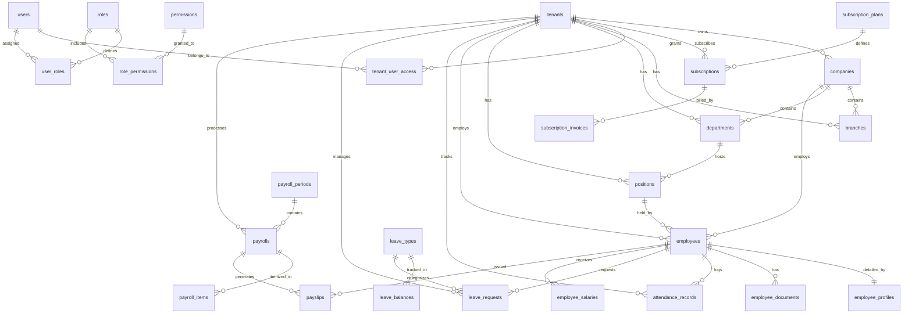

# DATABASE ERD & DATA DICTIONARY
## RiHRIS — PostgreSQL Schema Specification

**Database Engine:** PostgreSQL 16+  
**Standard Primary Key:** `bigserial` / `uuid`  
**Monetary Data Type:** `NUMERIC(15, 2)` (Strictly avoid floating point)  
**Tenant Discriminator:** `tenant_id` on all tenant-owned entities

---

## 1. ENTITY RELATIONSHIP DIAGRAM (ERD)

---

## 2. DATA DICTIONARY (KAMUS DATA TABEL UTAMA)

### 2.1 Domain SaaS & Multi-Tenancy

#### Tabel `tenants`
Menyimpan entitas penyewa utama platform.
| Kolom | Tipe Data | Constraint | Keterangan |
|---|---|---|---|
| `id` | BIGSERIAL | PK | ID unik penyewa |
| `uuid` | UUID | UNIQUE, NOT NULL | UUID publik penyewa |
| `name` | VARCHAR(255) | NOT NULL | Nama akun tenant/holding |
| `slug` | VARCHAR(100) | UNIQUE, NOT NULL | Subdomain slug (cth: `acme`) |
| `status` | VARCHAR(30) | NOT NULL, DEFAULT 'trial' | `trial`, `active`, `suspended`, `expired` |
| `trial_ends_at` | TIMESTAMP | NULL | Batas waktu masa percobaan |
| `created_at` | TIMESTAMP | NOT NULL | Waktu pembuatan entitas |
| `updated_at` | TIMESTAMP | NOT NULL | Waktu pembaruan entitas |

#### Tabel `companies`
Menyimpan profil legal perusahaan dalam naungan tenant.
| Kolom | Tipe Data | Constraint | Keterangan |
|---|---|---|---|
| `id` | BIGSERIAL | PK | ID unik perusahaan |
| `tenant_id` | BIGINT | FK -> tenants(id), NOT NULL | Induk penyewa |
| `name` | VARCHAR(255) | NOT NULL | Nama resmi PT / CV |
| `legal_name` | VARCHAR(255) | NULL | Nama akta notaris lengkap |
| `npwp` | VARCHAR(30) | NULL | Nomor Pokok Wajib Pajak Perusahaan |
| `email` | VARCHAR(255) | NOT NULL | Email resmi korespondensi |
| `phone` | VARCHAR(50) | NULL | Telepon kantor |
| `address` | TEXT | NULL | Alamat kantor pusat |
| `city` | VARCHAR(100) | NULL | Kota / Kabupaten |
| `province` | VARCHAR(100) | NULL | Provinsi |
| `postal_code` | VARCHAR(10) | NULL | Kode pos |
| `logo_path` | VARCHAR(255) | NULL | Lokasi file logo perusahaan |
| `created_at` | TIMESTAMP | NOT NULL | Timestamp |
| `updated_at` | TIMESTAMP | NOT NULL | Timestamp |

#### Tabel `company_settings`
Menyimpan konfigurasi kebijakan kerja dan kepatuhan perusahaan.
| Kolom | Tipe Data | Constraint | Keterangan |
|---|---|---|---|
| `id` | BIGSERIAL | PK | ID setting |
| `tenant_id` | BIGINT | FK -> tenants(id), NOT NULL | Induk penyewa |
| `company_id` | BIGINT | FK -> companies(id), NOT NULL | Perusahaan |
| `work_days_per_week` | SMALLINT | DEFAULT 5 | 5 atau 6 hari kerja sesuai PP 35/2021 |
| `regular_work_hours_per_day` | NUMERIC(4, 2) | DEFAULT 8.00 | Jam kerja harian normal (7 atau 8 jam) |
| `weekly_work_hour_limit` | NUMERIC(4, 2) | DEFAULT 40.00 | Batas maksimal jam kerja (40 jam/minggu) |
| `late_tolerance_minutes` | INTEGER | DEFAULT 15 | Toleransi keterlambatan presensi (menit) |
| `bpjs_kes_max_cap` | NUMERIC(15, 2) | DEFAULT 12000000.00 | Batas atas upah BPJS Kesehatan |
| `bpjs_tk_jp_max_cap` | NUMERIC(15, 2) | DEFAULT 10042300.00 | Batas atas upah Jaminan Pensiun |
| `jkk_risk_grade` | VARCHAR(20) | DEFAULT 'low' | Tingkat risiko JKK (`very_low`, `low`, `medium`, `high`, `very_high`) |
| `payroll_cutoff_day` | SMALLINT | DEFAULT 20 | Tanggal cut-off kehadiran bulanan |
| `payroll_payment_day` | SMALLINT | DEFAULT 25 | Tanggal pembayaran gaji |
| `created_at` | TIMESTAMP | NOT NULL | Timestamp |
| `updated_at` | TIMESTAMP | NOT NULL | Timestamp |

#### Tabel `subscription_plans`
| Kolom | Tipe Data | Constraint | Keterangan |
|---|---|---|---|
| `id` | BIGSERIAL | PK | ID paket |
| `name` | VARCHAR(100) | NOT NULL | Free Trial, Starter, Pro, Enterprise |
| `slug` | VARCHAR(100) | UNIQUE, NOT NULL | Slug identifikasi paket |
| `price_monthly` | NUMERIC(15, 2) | NOT NULL | Harga per bulan (IDR) |
| `price_yearly` | NUMERIC(15, 2) | NOT NULL | Harga per tahun (IDR) |
| `max_employees` | INTEGER | NOT NULL | Batas maksimal karyawan (misal: 50) |
| `max_admins` | INTEGER | NOT NULL | Batas admin (misal: 3) |
| `storage_limit_mb` | INTEGER | NOT NULL | Kuota penyimpanan dokumen (MB) |
| `features` | JSONB | NULL | Daftar fitur / modul yang aktif |
| `is_active` | BOOLEAN | DEFAULT TRUE | Status paket |

---

### 2.2 Domain User & Role-Based Access Control (RBAC)

#### Tabel `users`
| Kolom | Tipe Data | Constraint | Keterangan |
|---|---|---|---|
| `id` | BIGSERIAL | PK | ID User |
| `name` | VARCHAR(255) | NOT NULL | Nama lengkap pengguna |
| `email` | VARCHAR(255) | UNIQUE, NOT NULL | Alamat email login |
| `password` | VARCHAR(255) | NOT NULL | Hash password (bcrypt) |
| `phone` | VARCHAR(50) | NULL | Nomor kontak WhatsApp / HP |
| `is_super_admin` | BOOLEAN | DEFAULT FALSE | Flag otoritas Super Admin platform |
| `active_tenant_id` | BIGINT | NULL | Tenant context aktif saat ini |
| `email_verified_at` | TIMESTAMP | NULL | Waktu verifikasi email |
| `remember_token` | VARCHAR(100) | NULL | Token Remember Me |
| `created_at` | TIMESTAMP | NOT NULL | Timestamp |
| `updated_at` | TIMESTAMP | NOT NULL | Timestamp |

#### Tabel `roles`
| Kolom | Tipe Data | Constraint | Keterangan |
|---|---|---|---|
| `id` | BIGSERIAL | PK | ID Role |
| `tenant_id` | BIGINT | NULL | NULL = Global system role, Valued = Tenant role |
| `name` | VARCHAR(100) | NOT NULL | Super Admin, Company Admin, HR, Employee, dll |
| `slug` | VARCHAR(100) | NOT NULL | Identifier teknis (`company-admin`, `employee`) |
| `description` | TEXT | NULL | Penjelasan tanggung jawab peran |

#### Tabel `permissions`
| Kolom | Tipe Data | Constraint | Keterangan |
|---|---|---|---|
| `id` | BIGSERIAL | PK | ID Permission |
| `name` | VARCHAR(100) | NOT NULL | Nama izin yang mudah dibaca |
| `slug` | VARCHAR(100) | UNIQUE, NOT NULL | `employee.view`, `payroll.process`, dll |
| `module` | VARCHAR(50) | NOT NULL | Kelompok modul (`employee`, `payroll`, `leave`) |

---

### 2.3 Domain Organisasi & Karyawan

#### Tabel `departments`
| Kolom | Tipe Data | Constraint | Keterangan |
|---|---|---|---|
| `id` | BIGSERIAL | PK | ID Departemen |
| `tenant_id` | BIGINT | FK -> tenants(id), NOT NULL | Induk tenant |
| `company_id` | BIGINT | FK -> companies(id), NOT NULL | Perusahaan |
| `name` | VARCHAR(150) | NOT NULL | Human Resource, Finance, IT, Operasional |
| `code` | VARCHAR(50) | NULL | Kode unik departemen (cth: `HR-01`) |
| `parent_id` | BIGINT | FK -> departments(id), NULL | Hirarki induk departemen |

#### Tabel `positions`
| Kolom | Tipe Data | Constraint | Keterangan |
|---|---|---|---|
| `id` | BIGSERIAL | PK | ID Posisi / Jabatan |
| `tenant_id` | BIGINT | FK -> tenants(id), NOT NULL | Induk tenant |
| `department_id` | BIGINT | FK -> departments(id), NOT NULL | Departemen naungan |
| `title` | VARCHAR(150) | NOT NULL | Senior Software Engineer, HR Officer |
| `job_level` | VARCHAR(50) | NULL | Staff, Supervisor, Manager, Director |

#### Tabel `employees`
| Kolom | Tipe Data | Constraint | Keterangan |
|---|---|---|---|
| `id` | BIGSERIAL | PK | ID Karyawan |
| `tenant_id` | BIGINT | FK -> tenants(id), NOT NULL | Induk tenant |
| `company_id` | BIGINT | FK -> companies(id), NOT NULL | Perusahaan tempat bekerja |
| `user_id` | BIGINT | FK -> users(id), NULL | Akun login pengguna (jika aktif ESS) |
| `employee_number` | VARCHAR(50) | NOT NULL | NIK Karyawan internal (cth: `EMP-2024-001`) |
| `nik_ktp` | VARCHAR(20) | NULL | Nomor KTP 16 digit |
| `first_name` | VARCHAR(100) | NOT NULL | Nama depan |
| `last_name` | VARCHAR(100) | NULL | Nama belakang |
| `email` | VARCHAR(255) | NOT NULL | Email kerja |
| `phone` | VARCHAR(50) | NULL | Nomor telepon / HP |
| `gender` | VARCHAR(10) | NOT NULL | `male`, `female` |
| `birth_place` | VARCHAR(100) | NULL | Tempat lahir |
| `birth_date` | DATE | NULL | Tanggal lahir |
| `marital_status` | VARCHAR(30) | DEFAULT 'single' | `single`, `married`, `widowed`, `divorced` |
| `tax_ptkp_status` | VARCHAR(10) | DEFAULT 'TK/0' | `TK/0`, `TK/1`, `TK/2`, `TK/3`, `K/0`, `K/1`, `K/2`, `K/3` |
| `npwp` | VARCHAR(30) | NULL | NPWP 16 digit |
| `bpjs_tk_number` | VARCHAR(30) | NULL | Nomor kartu peserta BPJS KTK |
| `bpjs_kes_number` | VARCHAR(30) | NULL | Nomor kartu peserta BPJS Kesehatan |
| `department_id` | BIGINT | FK -> departments(id), NULL | Departemen |
| `position_id` | BIGINT | FK -> positions(id), NULL | Posisi jabatan |
| `employment_status`| VARCHAR(30) | NOT NULL | `pkwtt`, `pkwt`, `probation`, `internship` |
| `join_date` | DATE | NOT NULL | Tanggal mulai bekerja |
| `end_date` | DATE | NULL | Tanggal selesai kontrak (jika PKWT) |
| `bank_name` | VARCHAR(50) | NULL | Nama Bank (BCA, Mandiri, BNI, BRI) |
| `bank_account_number` | VARCHAR(50) | NULL | Nomor rekening transfer gaji |
| `bank_account_holder` | VARCHAR(150) | NULL | Nama pemilik rekening sesuai buku tabungan |
| `basic_salary` | NUMERIC(15, 2) | DEFAULT 0.00 | Upah pokok bulanan |
| `photo_path` | VARCHAR(255) | NULL | Path foto karyawan di storage |
| `status` | VARCHAR(30) | DEFAULT 'active' | `active`, `suspended`, `resigned`, `terminated` |

---

### 2.4 Domain Presensi, Lembur, & Cuti

#### Tabel `attendance_records`
| Kolom | Tipe Data | Constraint | Keterangan |
|---|---|---|---|
| `id` | BIGSERIAL | PK | ID Log Presensi |
| `tenant_id` | BIGINT | FK -> tenants(id), NOT NULL | Induk tenant |
| `employee_id` | BIGINT | FK -> employees(id), NOT NULL | Karyawan |
| `date` | DATE | NOT NULL | Tanggal presensi kerja |
| `clock_in` | TIME | NULL | Waktu clock in |
| `clock_out` | TIME | NULL | Waktu clock out |
| `clock_in_latitude` | NUMERIC(10, 7) | NULL | Koordinat GPS saat clock in |
| `clock_in_longitude` | NUMERIC(10, 7) | NULL | Koordinat GPS saat clock in |
| `clock_in_photo` | VARCHAR(255) | NULL | Selfie clock in |
| `status` | VARCHAR(30) | NOT NULL | `present`, `late`, `absent`, `leave`, `sick`, `holiday` |
| `late_minutes` | INTEGER | DEFAULT 0 | Durasi menit terlambat |
| `early_out_minutes`| INTEGER | DEFAULT 0 | Durasi menit pulang lebih awal |
| `work_hours` | NUMERIC(4, 2) | DEFAULT 0.00 | Total jam kerja efektif |

#### Tabel `leave_requests`
| Kolom | Tipe Data | Constraint | Keterangan |
|---|---|---|---|
| `id` | BIGSERIAL | PK | ID Permohonan Cuti |
| `tenant_id` | BIGINT | FK -> tenants(id), NOT NULL | Induk tenant |
| `employee_id` | BIGINT | FK -> employees(id), NOT NULL | Pemohon |
| `leave_type_id` | BIGINT | FK -> leave_types(id), NOT NULL | Jenis cuti |
| `start_date` | DATE | NOT NULL | Tanggal mulai cuti |
| `end_date` | DATE | NOT NULL | Tanggal akhir cuti |
| `total_days` | INTEGER | NOT NULL | Jumlah hari kerja yang diambil |
| `reason` | TEXT | NOT NULL | Alasan pengajuan |
| `attachment_path`| VARCHAR(255) | NULL | Surat dokter / bukti pendukung |
| `status` | VARCHAR(30) | DEFAULT 'pending' | `pending`, `approved`, `rejected`, `cancelled` |

---

### 2.5 Domain Payroll & Perpajakan

#### Tabel `payrolls`
| Kolom | Tipe Data | Constraint | Keterangan |
|---|---|---|---|
| `id` | BIGSERIAL | PK | ID Pembayaran Gaji Karyawan |
| `tenant_id` | BIGINT | FK -> tenants(id), NOT NULL | Induk tenant |
| `payroll_period_id`| BIGINT | FK -> payroll_periods(id), NOT NULL | Periode penggajian |
| `employee_id` | BIGINT | FK -> employees(id), NOT NULL | Karyawan penerima |
| `basic_salary` | NUMERIC(15, 2) | NOT NULL | Gaji pokok |
| `allowances_total`| NUMERIC(15, 2) | DEFAULT 0.00 | Total tunjangan tetap & tidak tetap |
| `overtime_pay` | NUMERIC(15, 2) | DEFAULT 0.00 | Upah lembur PP 35/2021 |
| `gross_salary` | NUMERIC(15, 2) | NOT NULL | Penghasilan bruto sebulan |
| `deductions_total`| NUMERIC(15, 2) | DEFAULT 0.00 | Total potongan |
| `bpjs_tk_employee`| NUMERIC(15, 2) | DEFAULT 0.00 | Potongan BPJS TK ditanggung pekerja (JHT 2% + JP 1%) |
| `bpjs_tk_employer`| NUMERIC(15, 2) | DEFAULT 0.00 | BPJS TK ditanggung pemberi kerja (JKK+JKM+JHT+JP) |
| `bpjs_kes_employee`| NUMERIC(15, 2) | DEFAULT 0.00 | BPJS Kesehatan 1% ditanggung pekerja |
| `bpjs_kes_employer`| NUMERIC(15, 2) | DEFAULT 0.00 | BPJS Kesehatan 4% ditanggung pemberi kerja |
| `pph21_tax` | NUMERIC(15, 2) | DEFAULT 0.00 | Potongan PPh 21 TER masa ini |
| `take_home_pay` | NUMERIC(15, 2) | NOT NULL | Gaji bersih akhir (THP) |
| `status` | VARCHAR(30) | DEFAULT 'draft' | `draft`, `reviewed`, `approved`, `paid` |

---

### 2.6 Domain Content Management System (CMS)

#### Tabel `cms_sliders`
| Kolom | Tipe Data | Constraint | Keterangan |
|---|---|---|---|
| `id` | BIGSERIAL | PK | ID Slide |
| `title` | VARCHAR(255) | NOT NULL | Judul hero |
| `subtitle` | TEXT | NULL | Penjelasan singkat |
| `image_url` | VARCHAR(255) | NULL | URL / Path gambar ilustrasi |
| `cta_text` | VARCHAR(100) | NULL | Label tombol (misal: "Coba Gratis 14 Hari") |
| `cta_url` | VARCHAR(255) | NULL | Link tujuan tombol |
| `order_index` | INTEGER | DEFAULT 0 | Urutan penayangan slide |
| `is_active` | BOOLEAN | DEFAULT TRUE | Status publikasi |

#### Tabel `cms_modules`, `cms_features`, `cms_faqs`, `cms_testimonials`, `cms_settings`
Menyimpan komponen konten dinamis yang dapat diubah Super Admin kapan pun tanpa mengganggu operasi kode aplikasi.

---
*Kamus data ini menjamin integritas relasional dan konsistensi tipe data di seluruh sistem.*

