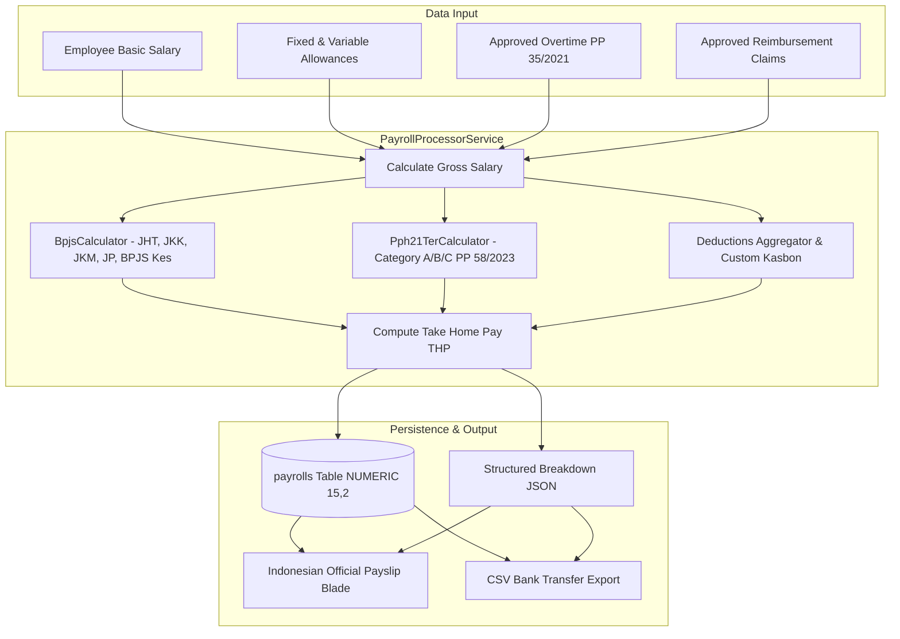

# DOKUMEN IMPLEMENTASI PHASE 3: PAYROLL, TAX & COMPLIANCE

**Platform:** RiHRIS — Multi-Company SaaS HRIS Indonesia  
**Versi Regulasi:** UU Cipta Kerja No. 6/2023, PP No. 35/2021, PP No. 58/2023, PMK No. 168/2023, Permenaker No. 6/2016  
**Status Implementasi:** Production Ready (Completed)

---

## 1. LANDASAN HUKUM & REGULASI KETENAGAKERJAAN RI

RiHRIS mengintegrasikan aturan formal ketenagakerjaan dan perpajakan Republik Indonesia secara bawaan (*statutory by design*):

| Komponen Kepatuhan | Dasar Hukum RI | Formula / Ketentuan Utama |
|---|---|---|
| **PPh 21 TER Bulanan** | PP No. 58/2023 & PMK No. 168/2023 | Kategori A, B, C berdasarkan status PTKP. Diterapkan langsung terhadap penghasilan bruto bulanan tanpa pembulatan tidak resmi. Surcharge 20% bagi yang tidak ber-NPWP. |
| **PPh 21 Masa Terakhir (Desember)** | Pasal 17 Ayat (1) Huruf a UU PPh / UU HPP | Rekonsiliasi tahunan: Bruto Setahun dikurangi Biaya Jabatan (5% maks Rp 6.000.000/tahun), iuran pensiun, dan PTKP. Tarif progresif 5%, 15%, 25%, 30%, 35%. Selisih terhadap TER adalah PPh 21 Desember. |
| **BPJS Ketenagakerjaan** | UU No. 24/2011 & PP Terkait | **JHT:** 3.7% Pemberi Kerja, 2.0% Pekerja. **JKM:** 0.3% Pemberi Kerja. **JKK:** Sesuai tingkat risiko (0.24% - 1.74%). **JP:** 2.0% Pemberi Kerja, 1.0% Pekerja (Batas upah tertinggi Rp 10.042.300). |
| **BPJS Kesehatan** | Perpres No. 64/2020 | 4.0% Pemberi Kerja, 1.0% Pekerja. Batas atas perhitungan upah maksimal Rp 12.000.000. |
| **Upah Lembur** | PP No. 35/2021 Pasal 31 & 32 | Upah per jam = `1/173 x Upah Sebulan (Pokok + Tunjangan Tetap)`. Jam ke-1 x 1.5, jam ke-2 dst x 2.0. Hari libur: Jam 1-8 x 2.0, Jam 9 x 3.0, Jam 10-12 x 4.0. |
| **Tunjangan Hari Raya (THR)** | Permenaker No. 6/2016 | Masa kerja &ge; 12 bulan: 1 bulan upah. Masa kerja 1 s.d. &lt; 12 bulan: `(Masa Kerja / 12) x Upah Sebulan`. Wajib dibayar maksimal H-7 hari raya. |
| **Uang Kompensasi PKWT** | PP No. 35/2021 Pasal 61A | Diberikan kepada pekerja PKWT dengan masa kerja minimal 1 bulan terus-menerus saat kontrak berakhir atau diperpanjang: `(Masa Kerja / 12) x 1 Bulan Upah`. |

---

## 2. ARSITEKTUR LAYANAN & DOMAIN SERVICES

---

## 3. FORMULASI MATEMATIKA DETAIL

### A. Perhitungan Gaji Pokok & Bruto
$$\text{Gross Salary} = \text{Gaji Pokok} + \sum \text{Tunjangan Tetap} + \sum \text{Tunjangan Variabel} + \text{Upah Lembur}$$

### B. Iuran BPJS Ketenagakerjaan & BPJS Kesehatan
$$\text{Upah Dasar BPJS} = \text{Gaji Pokok} + \sum \text{Tunjangan Tetap}$$
$$\text{Iuran JHT Pekerja} = 2.0\% \times \text{Upah Dasar BPJS}$$
$$\text{Iuran JP Pekerja} = 1.0\% \times \min(\text{Upah Dasar BPJS}, 10.042.300)$$
$$\text{Iuran BPJS Kes Pekerja} = 1.0\% \times \min(\text{Upah Dasar BPJS}, 12.000.000)$$
$$\text{Total Potongan BPJS Karyawan} = \text{JHT} + \text{JP} + \text{BPJS Kes}$$

### C. Pemotongan Pajak PPh 21 TER Bulanan
$$\text{Tarif TER} = f(\text{PTKP Status}, \text{Gross Salary}) \in \text{Tabel A, B, atau C}$$
$$\text{PPh 21 Bulanan} = \text{Gross Salary} \times \text{Tarif TER} \times (1.20 \text{ jika tanpa NPWP})$$

### D. Take Home Pay (THP)
$$\text{THP} = \text{Gross Salary} - \text{Total Potongan BPJS} - \text{Potongan Kustom} - \text{PPh 21 TER} + \text{Reimbursement Payout}$$

### E. Rekonsiliasi Pajak Masa Terakhir (Desember / 1721-A1)
$$\text{Biaya Jabatan} = \min(5\% \times \text{Bruto Setahun}, 6.000.000)$$
$$\text{Neto Setahun} = \text{Bruto Setahun} - \text{Biaya Jabatan} - \sum \text{BPJS Pensiun \& JHT}$$
$$\text{PKP} = \max\left(0, \lfloor \frac{\text{Neto Setahun} - \text{PTKP}}{1.000} \rfloor \times 1.000 \right)$$
$$\text{PPh 21 Desember} = \text{PPh 21 Setahun (Pasal 17)} - \sum_{m=1}^{11} \text{TER Bulanan}$$

---

## 4. TAMPILAN DAN MODUL YANG TERSEDIA

1. **Periode Penggajian (`company/payroll/index.blade.php`):** Dashboard siklus penggajian, status draft/processed/approved/paid, KPI total pembayaran.
2. **Detail Payroll & Line Items (`company/payroll/show.blade.php`):** Rekapitulasi per karyawan, tombol satu-klik hitung otomatis, persetujuan batch, dan ekspor CSV transfer bank.
3. **Slip Gaji Standar Indonesia (`company/payroll/payslip.blade.php`):** Format cetak resmi `@media print`, logo perusahaan, 2 kolom penerimaan dan potongan, transparansi iuran pemberi kerja, QR Code verifikasi digital.
4. **Master Komponen Gaji (`company/payroll/components.blade.php`):** Tunjangan tetap, tunjangan variabel, potongan kasbon, dan penetapan per karyawan.
5. **Kalkulasi THR Permenaker 6/2016 (`company/payroll/thr.blade.php`):** Kalkulasi otomatis 1 bulan upah vs pro-rata berdasarkan tanggal bergabung.
6. **Rekonsiliasi PPh 21 & Bukti Potong 1721-A1 (`company/payroll/tax_reconciliation.blade.php` & `1721_a1.blade.php`):** Formulir resmi DJP 1721-A1 digital.
7. **Reimbursement & Biaya (`company/reimbursement/index.blade.php`):** Alur verifikasi berjenjang: Pengajuan &rarr; Persetujuan Manajer &rarr; Persetujuan Finance &rarr; Cair (masuk payroll / lunas).
8. **Manajemen Kontrak PKWT & Kompensasi PP 35/2021 (`company/contracts/index.blade.php`):** Peringatan kontrak berakhir (&le; 30 hari), perhitungan otomatis uang kompensasi Pasal 61A, dan addendum perpanjangan kontrak.
9. **Employee Self-Service (ESS):** Portal mandiri karyawan untuk melihat slip gaji, mengajukan reimbursement beserta unggah kuitansi, dan memeriksa sisa masa kontrak.

