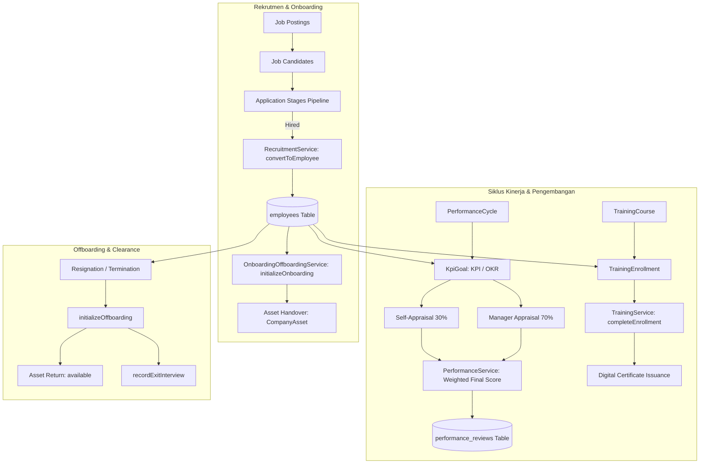

# DOKUMEN IMPLEMENTASI PHASE 4: TALENT MANAGEMENT

**Platform:** RiHRIS — Multi-Company SaaS HRIS Indonesia  
**Modul:** Rekrutmen (ATS), Onboarding & Offboarding, Manajemen Aset, Manajemen Kinerja (KPI/OKR), dan Pelatihan & Sertifikasi (L&D)  
**Status Implementasi:** Production Ready (Completed)

---

## 1. DESKRIPSI & CAKUPAN MODUL TALENTA

Modul **Talent Management** di RiHRIS dirancang untuk mengelola siklus hidup karyawan secara utuh (*end-to-end employee lifecycle*), mulai dari proses penarikan kandidat (*talent acquisition*), masa pengenalan kerja (*onboarding*), inventaris fasilitas kantor (*asset management*), penilaian kinerja objektif (*performance appraisal*), pengembangan kompetensi (*learning & development*), hingga proses pelepasan kerja (*offboarding & exit interview*).

Setiap sub-sistem menerapkan isolasi data multi-tenant ketat (`BelongsToTenant`) dan terhubung langsung dengan modul *Core HR* (Phase 2), *Payroll* (Phase 3), serta portal mandiri karyawan (*Employee Self-Service / ESS*).

---

## 2. ARSITEKTUR LAYANAN & DOMAIN SERVICES

---

## 3. SUB-SISTEM & FITUR UTAMA

### A. Rekrutmen & ATS Pipeline (`RecruitmentService`)
1. **Publikasi Lowongan (`JobPosting`):**
   - Penentuan departemen, jabatan target, rentang gaji (*salary min/max*), jenis ikatan kerja (*full-time*, *part-time*, *contract*, *internship*), deskripsi peran, dan tenggat waktu lamaran.
2. **Database Pelamar (`JobCandidate`):**
   - Penyimpanan terpusat data nama, kontak, URL profil LinkedIn, tautan portofolio, dan rekam jejak lamaran.
3. **Pipeline Pelamar 6 Tahap (`JobApplication`):**
   - `applied` &rarr; `screening` &rarr; `interview` &rarr; `offered` &rarr; `hired` &rarr; `rejected`.
   - Pencatatan jadwal wawancara, skor interview (0-100), catatan rekruter, dan surat penawaran (*offered salary*).
4. **Konversi Kandidat ke Karyawan (*Hire-to-Employee Conversion*):**
   - Saat status mencapai `hired`, `RecruitmentService::convertToEmployee()` secara otomatis membentuk entitas `Employee` aktif lengkap dengan nomor induk karyawan (NIK), departemen, dan gaji pokok tanpa duplikasi input data manual.

---

### B. Onboarding, Offboarding & Manajemen Aset (`OnboardingOffboardingService`)
1. **Standard Onboarding Checklist (6 Tahapan Baku):**
   - Pengumpulan & Verifikasi Berkas (KTP, NPWP, Ijazah, Buku Nikah).
   - Pembuatan Akun Email Perusahaan & Akses Sistem RiHRIS.
   - Penyerahan Kartu Tanda Pengenal (ID Card) & Akses Gedung.
   - Penyerahan Laptop & Perlengkapan Kerja Kantor (Handover Asset).
   - Sesi Orientasi Kebijakan Perusahaan, Peraturan Kerja & Budaya.
   - Pendaftaran Kepesertaan BPJS Ketenagakerjaan & BPJS Kesehatan.
2. **Standard Offboarding Checklist (6 Tahapan Clearance):**
   - Penyelesaian Serah Terima Tugas & Dokumentasi Pekerjaan (*Handover*).
   - Pengembalian Laptop, Charger, dan Perangkat Kantor.
   - Pengembalian ID Card & Akses Pintu/Gedung.
   - Penonaktifan Akun Email Perusahaan & Akses Sistem Internal.
   - Pelaksanaan Sesi Wawancara Keluar (*Exit Interview*).
   - Penerbitan Surat Keterangan Kerja (Paklaring) & Penghitungan Hak Akhir.
3. **Pelacakan Fasilitas & Inventaris Perusahaan (`CompanyAsset`):**
   - Kategori aset: `laptop`, `phone`, `vehicle`, `access_card`, `other`.
   - Siklus status: `available` &rarr; `assigned` (tertaut ke karyawan dan tanggal serah terima) &rarr; `available` (saat clearance dikembalikan).
4. **Wawancara Keluar (`ExitInterview`):**
   - Klasifikasi alasan pengunduran diri (`new_job`, `compensation`, `career_change`, `company_culture`, dll), umpan balik lingkungan kerja, dan kesediaan merekomendasikan perusahaan (*eNPS*).

---

### C. Manajemen Kinerja (KPI / OKR & Penilaian Berbobot)
1. **Siklus Evaluasi Kinerja (`PerformanceCycle`):**
   - Mendukung evaluasi berkala (Semesteran, Tahunan, atau Kuartalan).
2. **Sasaran Kerja Kuantitatif (`KpiGoal`):**
   - Pemisahan tipe `kpi` atau `okr`.
   - Nilai target (`target_value`), realisasi berjalan (`current_value`), satuan (`unit`), serta bobot persentase (`weight`).
   - Pembaruan realisasi mandiri secara berkala melalui portal ESS.
3. **Formulasi Penilaian Kinerja Berbobot (Weighted Appraisal):**
   RiHRIS menerapkan kombinasi evaluasi mandiri (*self-assessment*) dan ulasan atasan langsung (*manager review*):

$$\text{Pencapaian KPI} = \min\left(100\%, \frac{\text{Current Value}}{\text{Target Value}} \times 100\%\right)$$

$$\text{Final Appraisal Score} = \begin{cases} 
(30\% \times \text{Self Rating}) + (70\% \times \text{Manager Rating}), & \text{jika Self Rating diisi} \\
\text{Manager Rating}, & \text{jika tanpa Self Rating}
\end{cases}$$

---

### D. Pelatihan & Sertifikasi / L&D (`TrainingService`)
1. **Katalog & Jadwal Pelatihan (`TrainingCourse`):**
   - Kategori: `technical`, `leadership`, `compliance`, `soft_skills`.
   - Lokasi (*onsite* / *online zoom*), nama instruktur/lembaga, kuota kapasitas peserta, dan silabus.
2. **Pendaftaran & Kelulusan Peserta (`TrainingEnrollment`):**
   - Pendaftaran karyawan per program pelatihan.
   - Penilaian pasca-pelatihan (skala 0 - 100) dan catatan evaluasi instruktur.
3. **Penomoran Sertifikat Registrasi Unik:**
   Sertifikat digital diterbitkan secara otomatis dengan nomor seri terstandar:

$$\text{Certificate Number} = \text{CERT-}\{\text{YEAR}\}\text{-}\{\text{STR\_PAD}(\text{Course ID}, 4)\}\text{-}\{\text{STR\_PAD}(\text{Employee ID}, 4)\}$$

---

## 4. SKEMA TABEL DATABASE PHASE 4

| Nama Tabel | Deskripsi & Relasi Kunci |
|---|---|
| `job_postings` | Data lowongan kerja tenant, kualifikasi, rentang gaji, dan tenggat waktu. |
| `job_candidates` | Profil pelamar kerja, kontak, LinkedIn, dan portofolio. |
| `job_applications` | Pendaftaran lamaran, tahapan ATS, nilai interview, dan `converted_employee_id`. |
| `company_assets` | Inventaris perangkat kantor, kode aset, status ketersediaan, dan id pemegang. |
| `onboarding_offboarding_checklists` | Tugas checklist orientasi dan clearance pengunduran diri. |
| `exit_interviews` | Kuisioner wawancara keluar, alasan resign, dan evaluasi kultur kerja. |
| `performance_cycles` | Siklus periode penilaian performa (semester/tahunan). |
| `kpi_goals` | Target sasaran kerja individu (KPI/OKR), target, realisasi, dan bobot %. |
| `performance_reviews` | Rekapitulasi penilaian mandiri (30%), atasan (70%), dan skor akhir terbobot. |
| `training_courses` | Program pelatihan kompetensi, instruktur, jadwal, dan kapasitas. |
| `training_enrollments` | Pendaftaran peserta pelatihan, skor kelulusan, dan nomor sertifikat digital. |

---

## 5. INTEGRASI PORTAL EMPLOYEE SELF-SERVICE (ESS)

Karyawan memiliki akses mandiri melalui portal ESS untuk memantau dan mengelola aspek talenta mereka:
- **Tab Kinerja & Evaluasi Saya:**
  - Pemantauan progres batang capaian (*progress bar*) KPI / OKR individu.
  - Formulir pembaruan realisasi angka pencapaian secara berkala.
  - Formulir pengisian evaluasi mandiri (*self-appraisal*) untuk siklus aktif.
  - Transparansi skor evaluasi atasan dan catatan rekomendasi pengembangan.
- **Tab Aset & Pelatihan Saya:**
  - Daftar perangkat dan inventaris kantor yang sedang dipinjamkan.
  - Daftar periksa checklist orientasi/serah terima.
  - Riwayat program pelatihan yang telah diikuti beserta nomor sertifikat kelulusan.

---

## 6. SUITE PENGUJIAN OTOMATIS

Pengujian otomatis komprehensif diimplementasikan pada file:
`tests/Feature/TalentManagementPhase4Test.php`

Mencakup 6 skenario uji:
1. `test_recruitment_lifecycle_and_conversion_to_employee`: Validasi pembuatan loker, pelamar baru, transisi stage ATS, hingga konversi otomatis menjadi karyawan baru.
2. `test_onboarding_and_offboarding_checklist_workflow`: Inisialisasi 6 tugas checklist onboarding, penandaan penyelesaian tugas, inisialisasi offboarding, dan pencatatan exit interview.
3. `test_company_asset_handover_and_return`: Siklus lengkap registrasi aset, serah terima ke karyawan (`assigned`), dan pengembalian ke status `available`.
4. `test_performance_cycle_kpi_and_weighted_appraisal_scoring`: Verifikasi perhitungan progres KPI dan kalkulasi matematis skor terbobot 30/70.
5. `test_training_enrollment_and_certificate_generation`: Verifikasi pembuatan course, pendaftaran karyawan, kelulusan, dan format nomor sertifikat.
6. `test_talent_management_web_views_return_ok`: Aksesibilitas seluruh rute web HR dan portal ESS (HTTP 200).

