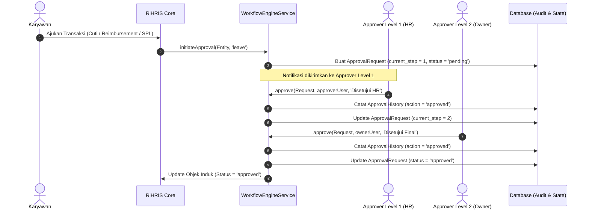

# DOKUMEN IMPLEMENTASI PHASE 5: ENTERPRISE SYSTEMS

**Platform:** RiHRIS — Multi-Company SaaS HRIS Indonesia  
**Modul:** Workflow Engine, Eksekutif Analitik & Laporan Lanjutan, Billing & Langganan SaaS, Enterprise API & Webhooks, Notifikasi WhatsApp, dan Audit Keamanan  
**Status Implementasi:** Production Ready (Completed)

---

## 1. DESKRIPSI & CAKUPAN MODUL ENTERPRISE

Fase 5 menghadirkan kemampuan skala perusahaan (*enterprise-grade capabilities*) pada platform **RiHRIS** untuk mendukung operasional multi-perusahaan bervolume tinggi, integrasi pihak ketiga, tata kelola alur kerja persetujuan berjenjang, pelaporan analitik strategis C-level, penegakan kepatuhan audit keamanan, serta integrasi omnichannel WhatsApp.

---

## 2. ARSITEKTUR WORKFLOW PERSISTEN & APPROVAL ENGINE

Sistem persetujuan berjenjang (*multi-level approval*) dirancang bersifat *data-driven*, sehingga perusahaan dapat menambahkan atau memodifikasi hierarki persetujuan (misalnya: *Team Leader &rarr; HR Manager &rarr; Finance &rarr; Owner*) tanpa mengubah kode aplikasi:

---

## 3. EKSEKUTIF ANALITIK & ENGINE EKSPOR LAPORAN

Layanan `HrAnalyticsService` menyediakan kalkulasi analitik waktu nyata (*real-time HR intelligence*) bagi para eksekutif:

### A. Formulasi Metrik Kunci
1. **Tingkat Pergantian Karyawan (Turnover Rate):**
$$\text{Turnover Rate} = \frac{\text{Jumlah Karyawan Resign/Terminasi}}{\text{Karyawan Aktif} + \text{Karyawan Resign/Terminasi}} \times 100\%$$

2. **Rasio Ketepatan Waktu Presensi (Punctuality Index):**
$$\text{Punctuality Rate} = \frac{\text{Total Presensi Masuk Tepat Waktu}}{\text{Total Seluruh Presensi Bulan Berjalan}} \times 100\%$$

3. **Distribusi Beban Finansial Payroll Perusahaan:**
$$\text{Total Beban Payroll Perusahaan} = \text{Gaji Bruto Karyawan} + \text{Iuran BPJS Pemberi Kerja} + \text{Klaim Reimbursement Operasional}$$

### B. Pusat Ekspor Data CSV Terstruktur
- **Laporan Data Karyawan (Headcount):** NIK, Nama, Email, Kontak, Departemen, Jabatan, Status PKWT/PKWTT, Tanggal Masuk, Gaji Pokok.
- **Laporan Presensi Bulanan:** NIK, Nama, Tanggal, Jam Masuk, Jam Pulang, Keterlambatan (Menit), Status Kehadiran.
- **Laporan Rekapitulasi Gaji (Payroll):** Periode, NIK, Nama, Gaji Pokok, Tunjangan, Lembur PP 35, Bruto, BPJS Karyawan, PPh 21 TER, THP.

---

## 4. SAAS BILLING, KUOTA & SUBSCRIPTION ENGINE

Layanan `SubscriptionBillingService` mengelola siklus pendapatan langganan multi-tenant:
1. **Tingkatan Paket (Subscription Plans):**
   - **Starter:** Hingga 20 karyawan, 2 admin, 1 GB storage.
   - **Professional:** Hingga 100 karyawan, 5 admin, 5 GB storage.
   - **Enterprise:** Skala tak terbatas (*unlimited*), integrasi API kustom, SLA 99.9%.
2. **Penomoran Faktur Elektronik Unik:**
$$\text{Invoice Number} = \text{INV-}\{\text{YEAR}\}\{\text{MONTH}\}\text{-}\{\text{STR\_PAD}(\text{Sequence}, 4)\}$$
3. **Penegakan Batasan Kuota (Metering & Enforcement):**
   - Pengecekan aktif `canAddEmployee($tenant)` mencegah penambahan karyawan melebihi paket yang dibayar.
4. **Simulator Pembayaran Multi-Kanal:**
   - Transfer Bank Manual (BCA & Mandiri), Virtual Account otomatis, QRIS, dan Kartu Kredit Korporat.

---

## 5. ENTERPRISE REST API & EVENT-DRIVEN WEBHOOKS

### A. Otentikasi REST API Mesin-ke-Mesin (`EnterpriseApiService`)
- Kunci API menggunakan format aman dengan prefix `ri_live_` + 32-karakter acak.
- Hanya hash SHA-256 yang disimpan di database (`key_hash`). Kunci mentah (*plain key*) hanya ditampilkan satu kali saat pembuatan.
- Dukungan header HTTP: `X-API-KEY: ri_live_xxxxxxxx` atau `Authorization: Bearer ri_live_xxxxxxxx`.

### B. Spesifikasi Endpoint REST API v1
| Method | Endpoint | Deskripsi |
|---|---|---|
| `GET` | `/api/v1/employees` | Mengambil daftar seluruh karyawan aktif tenant dengan paginasi. |
| `GET` | `/api/v1/employees/{id}` | Mengambil detail profil karyawan berdasarkan ID atau NIK. |
| `GET` | `/api/v1/attendance` | Mengambil data kehadiran harian berdasarkan parameter tanggal (`?date=YYYY-MM-DD`). |
| `POST` | `/api/v1/attendance` | Sinkronisasi data presensi dari mesin biometrik / RFID terminal eksternal. |

### C. Webhooks Event Delivery (`WebhookService`)
- Setiap pengiriman webhook dilengkapi header verifikasi HMAC SHA-256 signature (`X-RiHRIS-Signature`):
$$\text{Signature} = \text{hash\_hmac}('sha256', \text{json\_encode}(\text{payload}), \text{subscription\_secret})$$
- Event yang didukung: `employee.created`, `leave.approved`, `payroll.finalized`, `ping.test`.

---

## 6. DISPATCHER NOTIFIKASI WHATSAPP

Layanan `WhatsAppNotificationService` memformat dan mencatat pengiriman pesan instan ke nomor WhatsApp karyawan:
- **Slip Gaji Siap (Payslip Published):** Mengirimkan rincian periode dan nominal THP bersih.
- **Pembaruan Status Cuti (Leave Approval):** Memberitahukan persetujuan atau alasan penolakan permohonan cuti.
- **Pengingat Perpanjangan Kontrak (Contract Expiration):** Mengirimkan notifikasi menjelang berakhirnya PKWT sesuai ketentuan kompensasi PP 35/2021.

---

## 7. KEAMANAN AKSES, AUDIT LOG & IP WHITELIST

1. **Jejak Audit Kekal (*Immutable Audit Trail*):**
   - Tabel `audit_logs` merekam seluruh aksi sensitif (login, perubahan setting, proses penggajian, pembuatan karyawan) lengkap dengan ID aktor, IP address, user agent, data sebelum (*old values*), dan data sesudah (*new values*).
2. **Pembatasan Alamat IP Korporat (IP Whitelist):**
   - Perusahaan dapat membatasi akses login dashboard hanya dari IP kantor resmi atau VPN internal perusahaan (`company_ip_whitelists`).

---

## 8. SUITE PENGUJIAN OTOMATIS PHASE 5

Pengujian diimplementasikan pada file:
`tests/Feature/EnterprisePhase5Test.php`

Mencakup 7 skenario pengujian komprehensif:
1. `test_workflow_engine_multi_level_approval_flow`: Pengujian alur persetujuan 2 level, perpindahan status pending ke approved, dan sinkronisasi status ke model pengajuan cuti.
2. `test_hr_analytics_metrics_and_csv_exports`: Validasi perhitungan metrik C-level dan pembuatan streaming CSV headcount, presensi, dan payroll.
3. `test_subscription_billing_invoicing_and_quota`: Pembuatan faktur, konfirmasi pembayaran, dan validasi kuota lisensi karyawan.
4. `test_enterprise_api_keys_and_rest_endpoints`: Pengujian otentikasi kunci API (401 jika tanpa kunci, 200 dengan kunci) dan endpoint sinkronisasi presensi biometrik (201 Created).
5. `test_webhook_subscription_and_dispatch`: Pengujian registrasi webhook dan pengiriman event delivery payload.
6. `test_audit_logging_and_ip_whitelist`: Perekaman log audit dan validasi logika pembatasan IP whitelist korporat.
7. `test_enterprise_web_views_return_ok`: Aksesibilitas seluruh halaman web antarmuka enterprise (HTTP 200).

