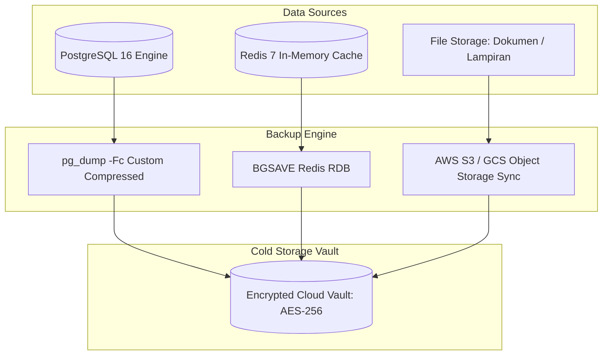

# PANDUAN PENCADANGAN & PEMULIHAN SISTEM (BACKUP & DISASTER RECOVERY)

**Platform:** RiHRIS — Multi-Company SaaS HRIS Indonesia  
**RTO (Recovery Time Objective):** < 30 Menit  
**RPO (Recovery Point Objective):** < 1 Jam  
**Status:** Production Ready  

---

## 1. STRATEGI PENCADANGAN MULTI-TIER

RiHRIS mengelola data sensitif ketenagakerjaan, identitas KTP/NPWP, nomor rekening perbankan, dan data perhitungan gaji. Oleh karena itu, strategi pencadangan dibagi ke dalam 3 tier:



---

## 2. PENCADANGAN BASIS DATA POSTGRESQL

### A. Eksekusi Pencadangan Manual via Docker Compose
Jalankan perintah berikut untuk menghasilkan berkas dump terkompresi:

```bash
# Buat direktori cadangan lokal
mkdir -p ./backups/database

# Jalankan dump PostgreSQL format kustom terkompresi
docker compose exec -T postgres pg_dump -U rihris_user -d rihris_db -Fc -Z 9 > ./backups/database/rihris_db_$(date +%Y%m%d_%H%M%S).dump
```

### B. Otomatisasi Pencadangan Terjadwal (Cron Job)
Tambahkan entri cron berikut pada host server (`crontab -e`):

```cron
# Eksekusi backup database setiap 6 jam
0 */6 * * * /usr/local/bin/rihris-backup-db.sh >> /var/log/rihris-backup.log 2>&1
```

Script bash pendukung (`/usr/local/bin/rihris-backup-db.sh`):
```bash
#!/bin/bash
set -e

BACKUP_DIR="/opt/rihris/backups/database"
DATE=$(date +%Y%m%d_%H%M%S)
FILENAME="rihris_backup_${DATE}.dump"

mkdir -p "$BACKUP_DIR"

docker exec -t rihris-postgres pg_dump -U rihris_user -d rihris_db -Fc -Z 9 > "${BACKUP_DIR}/${FILENAME}"

# Hapus backup yang lebih tua dari 14 hari
find "$BACKUP_DIR" -type f -name "*.dump" -mtime +14 -exec rm {} \;

echo "[${DATE}] Backup database berhasil dibuat: ${FILENAME}"
```

---

## 3. PENCADANGAN ASSET DAN DOKUMEN DIGITAL (STORAGE)

Semua dokumen unggahan (KTP karyawan, NPWP, resep reimbursement, surat kontrak kerja) tersimpan di direktori `storage/app/public/`.

### Sinkronisasi ke Cloud Storage (S3 / R2):
```bash
# Menggunakan AWS CLI atau Rclone
aws s3 sync ./storage/app/public s3://my-rihris-backup-bucket/documents/ --delete
```

---

## 4. PROSEDUR PEMULIHAN SISTEM (DISASTER RECOVERY RUNBOOK)

Jika terjadi insiden kehilangan data atau kegagalan server total (*catastrophic failure*), ikuti langkah-langkah pemulihan berikut secara berurutan:

### Langkah 1: Persiapan Environment Bersih
Pastikan seluruh kontainer berjalan dan koneksi database PostgreSQL siap:
```bash
docker compose up -d postgres redis
docker compose ps
```

### Langkah 2: Reset Database Target
```bash
# Hapus dan buat ulang database kosong
docker compose exec postgres dropdb -U rihris_user rihris_db --if-exists
docker compose exec postgres createdb -U rihris_user rihris_db
```

### Langkah 3: Eksekusi Restorasi Database
```bash
# Pulihkan dari berkas dump kustom
docker compose exec -T postgres pg_restore -U rihris_user -d rihris_db -v < ./backups/database/rihris_db_20261106_120000.dump
```

### Langkah 4: Pemulihan Berkas Dokumen (Storage)
```bash
# Pulihkan folder dokumen dari S3 atau arsip tar
tar -xzf ./backups/storage_assets.tar.gz -C ./storage/app/public/
```

### Langkah 5: Bersihkan Cache dan Verifikasi
```bash
docker compose exec app php artisan optimize:clear
docker compose exec app php artisan config:cache
docker compose exec app php artisan route:cache
docker compose exec app php artisan view:cache
```

### Langkah 6: Jalankan Verifikasi Uji Otomatis
```bash
docker compose exec app php artisan test --filter=ComplianceCalculationTest
```

---

## 5. KEBIJAKAN RETENSI CADANGAN (RETENTION POLICY)

| Interval | Frekuensi | Masa Retensi |
|---|---|---|
| **Daily Backups** | Setiap 6 Jam | Disimpan selama 7 hari |
| **Weekly Backups** | Setiap Minggu (Pukul 02.00) | Disimpan selama 4 minggu |
| **Monthly Backups** | Hari pertama tiap bulan | Disimpan selama 12 bulan |
| **Annual Compliance** | 31 Desember | Disimpan selama 5 tahun (UU Perpajakan) |
