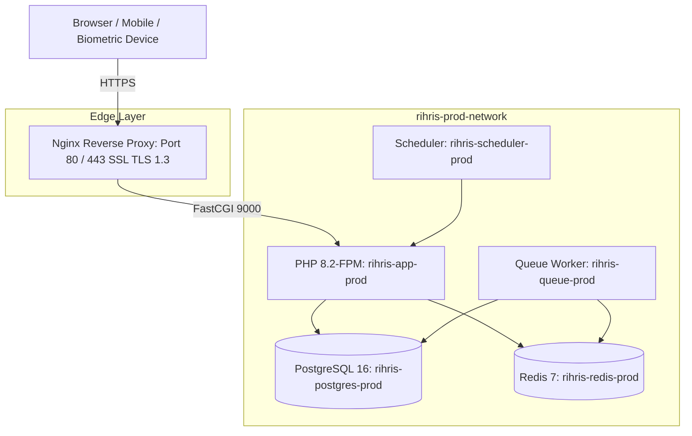

# PANDUAN DEPLOYMENT PRODUKSI (PRODUCTION DEPLOYMENT RUNBOOK)

**Platform:** RiHRIS — Multi-Company SaaS HRIS Indonesia  
**Target OS:** Ubuntu 22.04 / 24.04 LTS (x86_64)  
**Docker Engine:** 24.0+ & Docker Compose v2.20+  
**Status:** Production Ready  

---

## 1. PERSYARATAN MINIMAL INFRASTRUKTUR PRODUKSI

Untuk melayani hingga 100 perusahaan aktif dan 10.000 karyawan:

| Komponen | Spesifikasi Minimum Rekomendasi |
|---|---|
| **CPU** | 4 vCPU (Intel Xeon / AMD EPYC) |
| **RAM** | 8 GB ECC RAM (16 GB disarankan untuk high volume payroll) |
| **Penyimpanan** | 100 GB SSD NVMe (I/O intensif untuk log presensi & audit) |
| **Bandwidth** | 100 Mbps Unmetered |
| **OS** | Ubuntu Server 22.04 LTS / 24.04 LTS |

---

## 2. ARSITEKTUR KONTROL JARINGAN & CONTAINER PRODUKSI



---

## 3. CHECKLIST KEAMANAN & HARDENING SEBELUM DEPLOY

1. **`APP_DEBUG=false`**: Pastikan stack trace error tidak pernah terekspos ke publik.
2. **`APP_ENV=production`**: Mengaktifkan mode produksi Laravel.
3. **`SESSION_SECURE_COOKIE=true`**: Memastikan cookie sesi hanya dikirim melalui koneksi HTTPS.
4. **`DB_PASSWORD` & `REDIS_PASSWORD`**: Gunakan kata sandi berkekuatan tinggi (minimal 32 karakter acak).
5. **Firewall (UFW)**: Hanya buka Port 22 (SSH), Port 80 (HTTP redirect), dan Port 443 (HTTPS). Tutup akses langsung Port 5432 (Postgres) dan 6379 (Redis) dari internet publik.

---

## 4. LANGKAH-LANGKAH DEPLOYMENT PRODUKSI

### Langkah 1: Clone Repositori ke Server Produksi
```bash
cd /var/www
git clone <repository_url> rihris
cd rihris
```

### Langkah 2: Konfigurasi Berkas `.env` Produksi
```bash
cp .env.example .env
nano .env
```

Pastikan variabel kunci berikut terkonfigurasi dengan benar:
```ini
APP_NAME=RiHRIS
APP_ENV=production
APP_KEY=base64:GENERATE_VIA_ARTISAN_KEY_GENERATE
APP_DEBUG=false
APP_URL=https://app.rihris.id

DB_CONNECTION=pgsql
DB_HOST=postgres
DB_PORT=5432
DB_DATABASE=rihris_db_prod
DB_USERNAME=rihris_admin_prod
DB_PASSWORD=YOUR_SUPER_SECURE_PG_PASSWORD_32_CHARS

REDIS_HOST=redis
REDIS_PORT=6379
REDIS_PASSWORD=YOUR_SUPER_SECURE_REDIS_PASSWORD

QUEUE_CONNECTION=redis
CACHE_STORE=redis
SESSION_DRIVER=redis

MAIL_MAILER=smtp
MAIL_HOST=smtp.sendgrid.net
MAIL_PORT=587
MAIL_USERNAME=apikey
MAIL_PASSWORD=YOUR_SENDGRID_KEY
MAIL_ENCRYPTION=tls
MAIL_FROM_ADDRESS="no-reply@rihris.id"
MAIL_FROM_NAME="RiHRIS Platform"
```

### Langkah 3: Build & Jalankan Kontainer Produksi
Gunakan berkas konfigurasi produksi `docker-compose.prod.yml`:

```bash
docker compose -f docker-compose.prod.yml up -d --build
```

### Langkah 4: Inisialisasi Database & Optimasi Cache Laravel
```bash
# 1. Jalankan migrasi database
docker compose -f docker-compose.prod.yml exec app php artisan migrate --force

# 2. Jalankan master seeder (Hanya pada server baru)
docker compose -f docker-compose.prod.yml exec app php artisan db:seed --force

# 3. Buat symbolic link storage
docker compose -f docker-compose.prod.yml exec app php artisan storage:link

# 4. Cache konfigurasi, rute, dan view untuk performa maksimal
docker compose -f docker-compose.prod.yml exec app php artisan config:cache
docker compose -f docker-compose.prod.yml exec app php artisan route:cache
docker compose -f docker-compose.prod.yml exec app php artisan view:cache
docker compose -f docker-compose.prod.yml exec app php artisan event:cache
```

---

## 5. KONFIGURASI SSL / TLS DENGAN LET'S ENCRYPT CERTBOT

Jika menggunakan Nginx host reverse proxy:

```bash
sudo apt install -y certbot python3-certbot-nginx
sudo certbot --nginx -d app.rihris.id -d www.rihris.id
```

Certbot akan memperbarui sertifikat SSL secara otomatis setiap 90 hari melalui systemd timer.

---

## 6. SCRIPT ZERO-DOWNTIME UPDATE (CI/CD DEPLOYMENT)

Simpan script berikut di server pada `/usr/local/bin/rihris-deploy.sh`:

```bash
#!/bin/bash
set -e

echo "=== Memulai Proses Pembaruan RiHRIS Produksi ==="
cd /var/www/rihris

# 1. Masuk mode maintenance
docker compose -f docker-compose.prod.yml exec app php artisan down --render="errors.503" --secret="BypassSecret2026"

# 2. Ambil commit terbaru
git pull origin main

# 3. Jalankan migrasi baru jika ada
docker compose -f docker-compose.prod.yml exec app php artisan migrate --force

# 4. Perbarui cache optimasi
docker compose -f docker-compose.prod.yml exec app php artisan optimize:clear
docker compose -f docker-compose.prod.yml exec app php artisan config:cache
docker compose -f docker-compose.prod.yml exec app php artisan route:cache
docker compose -f docker-compose.prod.yml exec app php artisan view:cache

# 5. Restart worker queue agar memuat kode baru
docker compose -f docker-compose.prod.yml restart queue

# 6. Matikan mode maintenance
docker compose -f docker-compose.prod.yml exec app php artisan up

echo "=== Deployment Selesai Sukses! ==="
```
