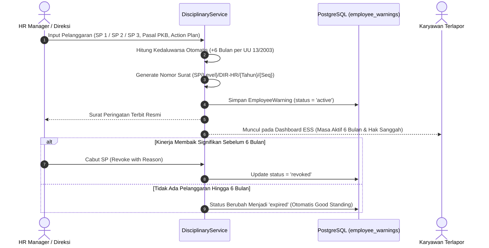

# DOKUMEN IMPLEMENTASI PHASE 6: EMPLOYEE RELATIONS & ENGAGEMENT

**Platform:** RiHRIS — Multi-Company SaaS HRIS Indonesia  
**Modul:** Hubungan Industrial, Surat Peringatan (SP1, SP2, SP3), Kanal Pengaduan & Whistleblowing, Papan Pengumuman Internal, dan HR Helpdesk Service Request  
**Status Implementasi:** Production Ready (Completed)

---

## 1. DESKRIPSI & LANDASAN HUKUM KETENAGAKERJAAN INDONESIA

Fase 6 melengkapi ekosistem platform **RiHRIS** dengan kemampuan tata kelola hubungan industrial (*industrial relations*) dan pelibatan karyawan (*employee engagement*) sesuai regulasi ketenagakerjaan Republik Indonesia:

1. **Pasal 161 UU Ketenagakerjaan No. 13/2003 jo. UU Cipta Kerja No. 6/2023 & PP No. 35/2021:**
   - Surat Peringatan (SP) terdiri dari **Surat Peringatan Pertama (SP 1)**, **Surat Peringatan Kedua (SP 2)**, dan **Surat Peringatan Ketiga (SP 3)**.
   - Ketentuan masa berlaku masing-masing surat peringatan adalah paling lama **6 (enam) bulan**, kecuali ditetapkan lain dalam Perjanjian Kerja Bersama (PKB) atau Peraturan Perusahaan (PP).
   - RiHRIS mengotomatiskan penghitungan batas kedaluwarsa 6 bulan secara ketat:
     $$\text{valid\_until} = \text{issued\_date} + 6\text{ bulan}$$
   - Apabila pekerja melakukan pelanggaran ketentuan sebelum masa 6 bulan berakhir, pengusaha dapat menerbitkan SP tingkat berikutnya.
   - Jika masa 6 bulan telah terlampaui tanpa adanya pelanggaran baru, catatan SP kedaluwarsa secara otomatis dan status pekerja kembali dalam posisi *good standing*.

2. **Kerahasiaan Pelapor & Saluran Whistleblowing (Zero-Retaliation Policy):**
   - Karyawan memiliki hak melaporkan indikasi pelecehan seksual, intimidasi (*bullying*), diskriminasi, maupun perselisihan hak secara aman dan anonim.
   - Sistem menjamin nama dan data pelapor disamarkan dari pihak terlapor dan atasan langsung demi mencegah tindakan balasan atau pembalasan sanksi di lingkungan kerja.

3. **Standardisasi Layanan Administratif Karyawan (HR Helpdesk):**
   - Menghilangkan proses permohonan surat manual yang lambat melalui pembuatan nomor tiket otomatis (`TICK-YYYYMM-XXXX`) untuk Surat Keterangan Kerja (Paklaring), surat sponsor visa/KPR bank, pembaruan data keluarga, dan konsultasi BPJS Ketenagakerjaan/Kesehatan.

---

## 2. ARSITEKTUR HUBUNGAN INDUSTRIAL & DISIPLIN KERJA

### Alur Penerbitan dan Masa Berlaku Surat Peringatan (SP)

---

## 3. STRUKTUR DATABASE PHASE 6

Tabel-tabel relasional disimpan dalam skema database PostgreSQL dengan isolasi *multi-tenant* (`tenant_id`):

| Nama Tabel | Peran & Deskripsi | Kunci & Kolom Utama |
| :--- | :--- | :--- |
| `employee_warnings` | Catatan Surat Peringatan resmi (SP1, SP2, SP3) | `letter_number`, `employee_id`, `warning_level`, `issued_date`, `valid_until`, `reason`, `action_plan`, `status` (`active`, `revoked`, `expired`), `authorized_by_user_id` |
| `employee_grievances` | Laporan keluhan, aspirasi, dan whistleblowing | `employee_id`, `category` (`workplace_conflict`, `harassment`, `compensation`, `facility`, `unfair_treatment`, `other`), `subject`, `description`, `is_anonymous`, `status`, `investigation_notes`, `resolution_notes`, `resolved_by_user_id` |
| `company_announcements` | Edaran internal, pengumuman libur, dan kebijakan | `title`, `content`, `category` (`general`, `policy`, `holiday`, `event`, `urgent`), `target_department_id` (nullable = seluruh divisi), `is_pinned`, `published_at`, `expires_at`, `created_by_user_id` |
| `hr_helpdesk_tickets` | Antrean tiket permohonan layanan & surat HR | `ticket_number` (`TICK-YYYYMM-XXXX`), `employee_id`, `category` (`work_certificate`, `bank_reference`, `data_correction`, `bpjs_inquiry`, `general`), `subject`, `description`, `status`, `assigned_to_user_id`, `resolution_notes`, `resolved_at` |

---

## 4. DAFTAR SERVICE & CONTROLLER

### A. Domain Services
1. **`App\Services\EmployeeRelations\DisciplinaryService`**:
   - `issueWarning(Employee $employee, array $data, ?User $author): EmployeeWarning`: Menghitung masa 6 bulan secara otomatis, menomori surat resmi, dan mencatat riwayat pembinaan.
   - `revokeWarning(EmployeeWarning $warning, ?string $reason): EmployeeWarning`: Mencabut status SP aktif lebih awal dengan dokumentasi perbaikan kinerja.

2. **`App\Services\EmployeeRelations\GrievanceService`**:
   - `submitGrievance(Employee $employee, array $data): EmployeeGrievance`: Merekam laporan masalah kerja dengan opsi anonimitas pelapor.
   - `updateStatus(EmployeeGrievance $grievance, string $status, ?string $notes)`: Memperbarui perkembangan penanganan dari *submitted &rarr; in_review &rarr; investigating*.
   - `resolveGrievance(EmployeeGrievance $grievance, User $resolvedBy, string $notes)`: Menyelesaikan perselisihan mediasi dan mencatat solusi final.

3. **`App\Services\EmployeeRelations\EngagementService`**:
   - `createAnnouncement(string $tenantId, array $data, ?User $author): CompanyAnnouncement`: Memublikasikan edaran ke seluruh karyawan atau departemen spesifik dengan opsi *pin to top*.
   - `createTicket(Employee $employee, array $data): HrHelpdeskTicket`: Menghasilkan tiket layanan dengan kode unik bulanan terurut.
   - `resolveTicket(HrHelpdeskTicket $ticket, User $resolver, string $notes)`: Menyelesaikan tiket dan memberikan catatan dokumen/legalitas ke karyawan pemohon.

### B. Controllers & Rute Antarmuka Web
1. **`App\Http\Controllers\Company\DisciplinaryController`** (`/disciplinary`):
   - `index`: Menampilkan statistik SP aktif, daftar tabel SP, countdown hari tersisa masa berlaku, dan filter status.
   - `store`: Form modal penerbitan SP1/SP2/SP3 lengkap dengan target perbaikan kinerja (*action plan*).
   - `revoke`: Modal pencabutan SP aktif.
2. **`App\Http\Controllers\Company\GrievanceController`** (`/grievances`):
   - `index`: Manajemen saluran aduan, badge anonimitas (*whistleblower protection*), dan antrean laporan.
   - `updateStatus`: Pembaruan status investigasi.
   - `resolve`: Form catatan mediasi dan penyelesaian aduan.
3. **`App\Http\Controllers\Company\AnnouncementController`** (`/announcements`):
   - `index`: Grid kartu buletin pengumuman dengan label urgensi dan target departemen.
   - `store`: Publikasi pengumuman baru.
   - `destroy`: Hapus pengumuman.
4. **`App\Http\Controllers\Company\HelpdeskController`** (`/helpdesk`):
   - `index`: Antrean tiket permohonan layanan administratif karyawan.
   - `resolve`: Penyelesaian permohonan dan pencatatan nomor dokumen sah.
5. **`App\Http\Controllers\EmployeeDashboardController`** (`/ess/dashboard`):
   - Bulletin Banner Pengumuman Penting (Pinned to top).
   - Tab 11: "Layanan HR & Aspirasi" (`activeEssTab = 'grievance-helpdesk'`).
   - Kartu Status Disiplin & Kepatuhan Karyawan (Pasal 161 UU Ketenagakerjaan).
   - Form Pengajuan Tiket Layanan HR & Tabel Riwayat Tiket Saya.
   - Form Pengaduan Rahasia / Whistleblowing & Tabel Riwayat Aduan Saya.

---

## 5. CAKUPAN PENGUJIAN OTOMATIS (TEST SUITE)

Berkas pengujian fitur terletak di [tests/Feature/EmployeeRelationsAndEngagementPhase6Test.php](file:///d:/Frontend/hris-php/tests/Feature/EmployeeRelationsAndEngagementPhase6Test.php) dengan 6 skenario verifikasi:

1. `test_can_issue_warning_letter_sp1_with_automatic_6_month_expiry`:
   - Memvalidasi pembentukan nomor surat `SP1/DIR-HR/{YEAR}/{SEQ}`.
   - Memvalidasi kepatuhan Pasal 161 UU Ketenagakerjaan dengan formula `valid_until = issued_date + 6 bulan`.
2. `test_can_revoke_warning_letter_early`:
   - Memverifikasi pencabutan SP sebelum masa berlaku berakhir dan pencatatan alasan pencabutan.
3. `test_employee_can_submit_grievance_anonymously_and_hr_can_resolve`:
   - Memverifikasi pengiriman aduan anonim, transisi status `investigating`, dan resolusi mediasi akhir oleh HR.
4. `test_can_publish_announcement_with_target_department_and_pin_toggle`:
   - Memverifikasi publikasi pengumuman yang disematkan (*pinned*) dan pemfilteran berdasarkan departemen.
5. `test_employee_can_request_hr_helpdesk_ticket_and_hr_can_resolve`:
   - Memverifikasi pembuatan nomor tiket `TICK-YYYYMM-XXXX` dan resolusi penyelesaian tiket oleh staf HR.
6. `test_web_routes_accessibility_for_hr_and_ess`:
   - Menguji bahwa seluruh 5 rute web (Disiplin, Aduan, Pengumuman, Helpdesk, dan ESS Portal) merespon dengan kode status HTTP 200 OK.
