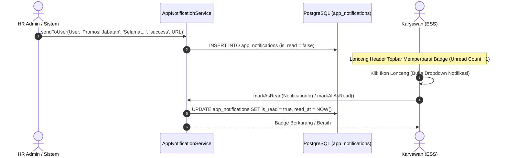

# DOKUMEN IMPLEMENTASI PHASE 7: CAREER TRANSITIONS, TERMINATIONS & NOTIFICATIONS

**Platform:** RiHRIS — Multi-Company SaaS HRIS Indonesia  
**Modul:** Pergerakan Karir (Mutasi, Promosi, Demosi), Kompensasi PHK & Pesangon (PP No. 35/2021 & UU Cipta Kerja), serta In-App Notification Center  
**Status Implementasi:** Production Ready (Completed)

---

## 1. DESKRIPSI & LANDASAN HUKUM KETENAGAKERJAAN INDONESIA

Fase 7 memperkuat platform **RiHRIS** pada aspek siklus hidup karir karyawan (*employee career lifecycle*), mitigasi risiko hukum saat pemutusan hubungan kerja (PHK), serta pusat notifikasi sistem terpadu:

1. **Pergerakan Karir (Mutasi, Promosi, Demosi & Penyesuaian Upah)**:
   - Pencatatan Surat Keputusan (SK) resmi pergerakan jabatan.
   - Otomatisasi pembaruan master data karyawan (`department_id`, `position_id`, dan `base_salary`) pada tanggal efektif SK.
   - Dokumentasi histori karir yang transparan dan dapat dipantau langsung oleh karyawan melalui portal ESS (*Career Journey*).

2. **Kalkulator Kompensasi PHK & Pesangon Statuter (PP No. 35 Tahun 2021 & Pasal 156 UU Cipta Kerja)**:
   - Menghilangkan kalkulasi manual yang rawan sengketa di Pengadilan Hubungan Industrial (PHI).
   - Menghitung secara otomatis seluruh komponen hak pekerja berdasarkan masa kerja dan alasan berakhirnya hubungan kerja.

3. **In-App Notification Center (Pusat Pemberitahuan Sistem)**:
   - Dropdown lonceng notifikasi interaktif di bilah atas aplikasi (*topbar*) dengan indikator jumlah pesan belum dibaca (*unread count badge*).
   - Mendukung pemberitahuan personal (*direct user*) maupun pengumuman siaran (*tenant-wide broadcast*).

---

## 2. MATRIKS KALKULASI PESANGON RESMI (PP NO. 35 TAHUN 2021)

### A. Uang Pesangon Pokok (UP) — Pasal 40 ayat (2)

| Masa Kerja Karyawan | Besaran Uang Pesangon (Bulan Upah) |
| :--- | :---: |
| Kurang dari 1 tahun | 1 bulan upah |
| 1 tahun s.d. < 2 tahun | 2 bulan upah |
| 2 tahun s.d. < 3 tahun | 3 bulan upah |
| 3 tahun s.d. < 4 tahun | 4 bulan upah |
| 4 tahun s.d. < 5 tahun | 5 bulan upah |
| 5 tahun s.d. < 6 tahun | 6 bulan upah |
| 6 tahun s.d. < 7 tahun | 7 bulan upah |
| 7 tahun s.d. < 8 tahun | 8 bulan upah |
| 8 tahun atau lebih | 9 bulan upah (Maksimum) |

### B. Uang Penghargaan Masa Kerja (UPMK) — Pasal 40 ayat (3)

| Masa Kerja Karyawan | Besaran UPMK (Bulan Upah) |
| :--- | :---: |
| Kurang dari 3 tahun | 0 bulan upah |
| 3 tahun s.d. < 6 tahun | 2 bulan upah |
| 6 tahun s.d. < 9 tahun | 3 bulan upah |
| 9 tahun s.d. < 12 tahun | 4 bulan upah |
| 12 tahun s.d. < 15 tahun | 5 bulan upah |
| 15 tahun s.d. < 18 tahun | 6 bulan upah |
| 18 tahun s.d. < 21 tahun | 7 bulan upah |
| 21 tahun s.d. < 24 tahun | 8 bulan upah |
| 24 tahun atau lebih | 10 bulan upah |

### C. Faktor Pengali Alasan PHK (Pasal 41 - 52 PP 35/2021)

| Alasan PHK / Terminasi | Pengali Pesangon (UP) | Hak UPMK | Hak UPH & Uang Pisah |
| :--- | :---: | :---: | :--- |
| **Resign Sukarela (Resignation)** | $0.0\times$ | $0\times$ | UPH Cuti + Uang Pisah (PKB/PP) |
| **Efisiensi karena Kerugian** | $0.5\times$ | $1\times$ | UPH Cuti Tahunan |
| **Perusahaan Tutup / Force Majeure** | $0.5\times$ | $1\times$ | UPH Cuti Tahunan |
| **Pelanggaran SP3 Berturut-turut** | $0.5\times$ | $1\times$ | UPH Cuti Tahunan |
| **Kesepakatan Bersama / Lainnya** | $1.0\times$ | $1\times$ | UPH Cuti Tahunan |
| **Mencapai Usia Pensiun Normal** | $1.75\times$ | $1\times$ | UPH Cuti Tahunan |
| **Sakit Berkepanjangan > 12 Bulan** | $2.0\times$ | $1\times$ | UPH Cuti Tahunan |
| **Pekerja Meninggal Dunia** | $2.0\times$ | $1\times$ | UPH Cuti Tahunan (ke Ahli Waris) |

$$\text{Total Kompensasi PHK} = (\text{Base UP} \times \text{Multiplier}) + \text{UPMK} + \text{UPH} + \text{Uang Pisah}$$

---

## 3. ARSITEKTUR NOTIFIKASI SISTEM (IN-APP)

---

## 4. STRUKTUR DATABASE PHASE 7

| Nama Tabel | Peran & Deskripsi | Kunci & Kolom Utama |
| :--- | :--- | :--- |
| `employee_mutations` | Catatan riwayat promosi, demosi, rotasi, penyesuaian gaji | `tenant_id`, `employee_id`, `type`, `from_department_id`, `to_department_id`, `from_position_id`, `to_position_id`, `from_salary`, `to_salary`, `effective_date`, `notes`, `created_by` |
| `employee_terminations` | Berkas resmi PHK dan kalkulasi kompensasi pesangon PP 35/2021 | `tenant_id`, `employee_id`, `letter_number`, `termination_type`, `termination_date`, `years_of_service`, `months_of_service`, `last_salary`, `severance_multiplier`, `severance_amount`, `upmk_amount`, `uph_amount`, `separation_pay_amount`, `total_severance`, `status`, `paid_at` |
| `app_notifications` | Pusat notifikasi internal aplikasi | `tenant_id`, `user_id` (nullable = broadcast), `title`, `message`, `type` (`info`, `warning`, `success`, `urgent`), `action_url`, `is_read`, `read_at` |

---

## 5. DAFTAR SERVICE & CONTROLLER

1. **`App\Services\Career\CareerTransitionService`**:
   - `recordTransition(Employee $employee, array $data, ?User $author): EmployeeMutation`: Menyimpan histori mutasi/promosi, memperbarui data master karyawan, dan mengirim notifikasi internal.
2. **`App\Services\Career\SeveranceCalculationService`**:
   - `calculateSeverance(Employee $employee, string $type, Carbon $date, ?float $salary, int $leave, float $separationPay): array`: Kalkulator simulasi pesangon statuter waktu nyata (*real-time statutory simulation*).
   - `recordTermination(Employee $employee, array $data, ?User $author): EmployeeTermination`: Menerbitkan SK PHK resmi (`SK-PHK/{YEAR}/{SEQ}`) dan menonaktifkan status karyawan.
   - `markAsPaid(EmployeeTermination $termination)`: Menandai pembayaran pesangon lunas (*paid*).
3. **`App\Services\Notification\AppNotificationService`**:
   - `sendToUser`, `sendToTenant`, `markAsRead`, `markAllAsRead`, `getRecentForUser`, `getUnreadCount`.
4. **Controllers**:
   - [`app/Http/Controllers/Company/MutationController.php`](file:///d:/Frontend/hris-php/app/Http/Controllers/Company/MutationController.php) (`/mutations`)
   - [`app/Http/Controllers/Company/TerminationController.php`](file:///d:/Frontend/hris-php/app/Http/Controllers/Company/TerminationController.php) (`/terminations`)
   - [`app/Http/Controllers/NotificationController.php`](file:///d:/Frontend/hris-php/app/Http/Controllers/NotificationController.php) (`/notifications`)

---

## 6. CAKUPAN PENGUJIAN OTOMATIS (TEST SUITE)

Berkas pengujian fitur terletak di [tests/Feature/CareerTransitionsAndSeverancePhase7Test.php](file:///d:/Frontend/hris-php/tests/Feature/CareerTransitionsAndSeverancePhase7Test.php) dengan 5 skenario verifikasi:

1. `test_can_record_employee_career_mutation_and_update_employee_record`:
   - Menguji penerbitan SK promosi jabatan, penyesuaian gaji dari Rp 8.000.000 ke Rp 12.500.000, pembaruan master data karyawan, dan notifikasi sukses.
2. `test_can_calculate_statutory_severance_under_pp35_2021`:
   - Memvalidasi formula PP 35/2021 untuk masa kerja 3 tahun 4 bulan: 4 bulan UP $\times 0.5$ (efisiensi) + 2 bulan UPMK + UPH cuti 5 hari.
3. `test_can_record_termination_and_mark_as_paid`:
   - Memverifikasi pembuatan nomor surat `SK-PHK/{YEAR}/{SEQ}`, penonaktifan status karyawan menjadi `inactive`, dan pembaruan status `paid`.
4. `test_in_app_notification_flow`:
   - Memvalidasi pengiriman notifikasi, penghitungan jumlah pesan belum dibaca (*unread count*), dan fungsi tandai semua dibaca (*mark all as read*).
5. `test_web_routes_for_mutations_and_terminations`:
   - Menguji bahwa rute web mutasi, terminasi, kalkulator API JSON, dan notifikasi merespons dengan kode status HTTP 200 OK.

