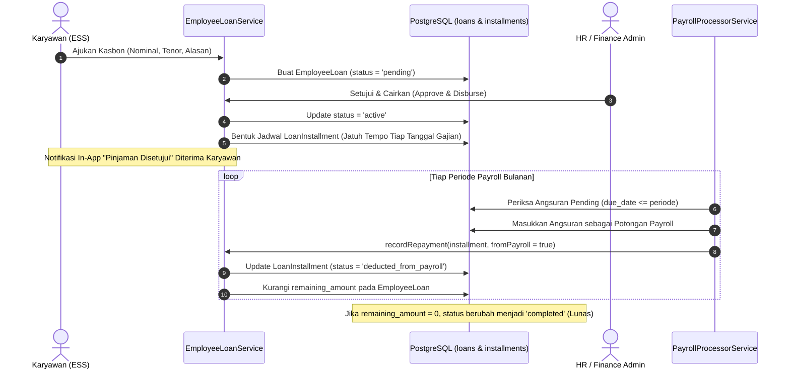

# DOKUMEN IMPLEMENTASI PHASE 8: FINANCIAL WELL-BEING & ADVANCED ENGAGEMENT

**Platform:** RiHRIS — Multi-Company SaaS HRIS Indonesia  
**Modul:** Pinjaman Karyawan & Kasbon Gaji, Survei Kepuasan Kerja & eNPS, Papan Apresiasi (Wall of Recognition / Kudos), dan Kalender Agenda Perusahaan  
**Status Implementasi:** Production Ready (Completed)

---

## 1. DESKRIPSI & LANDASAN MODUL

Fase 8 melengkapi platform **RiHRIS** dengan pilar kesejahteraan finansial karyawan (*employee financial well-being*) dan pelibatan tim tingkat lanjut (*advanced engagement*) yang diamanatkan pada Section 10.F dan 10.R dokumen spesifikasi:

1. **Fasilitas Pinjaman & Kasbon Gaji (Salary Advance / Emergency Loan)**:
   - Karyawan dapat mengajukan kasbon darurat atau pinjaman lunak secara mandiri melalui portal ESS.
   - Perusahaan mengelola plafon, suku bunga (0% untuk kasbon internal), dan tenor angsuran (1 s.d. 24 bulan).
   - Jadwal angsuran bulanan (*installment repayment schedule*) terbentuk otomatis saat pinjaman dicairkan dan terintegrasi dengan pemotongan payroll (*payroll deduction*).

2. **Survei Kepuasan Karyawan & Metrik eNPS (Employee Net Promoter Score)**:
   - Kampanye survei berkala guna mengukur loyalitas, keterlibatan, dan budaya kerja.
   - Mendukung opsi partisipasi anonim penuh (*100% anonymous survey*) guna memastikan masukan yang jujur dan objektif.
   - Dashboard analitik otomatis menghitung skor eNPS per kuartal.

3. **Papan Apresiasi Karyawan (Wall of Fame / Kudos)**:
   - Budaya apresiasi positif (*peer-to-peer* dan *manager-to-employee recognition*) berdasarkan nilai-nilai budaya perusahaan.
   - Pilihan lencana keunggulan (*badges*) dan insentif bonus penghargaan (*spot reward*).

4. **Kalender Acara & Agenda Perusahaan (Company Events)**:
   - Jadwal kegiatan resmi (All-Hands Townhall, Outing / Gathering, Rapat Strategis, Workshop).
   - Terintegrasi langsung pada tampilan portal ESS masing-masing divisi.

---

## 2. METODOLOGI & FORMULASI TEKNIS

### A. Formulasi Bunga & Angsuran Pinjaman

$$\text{Total Bunga} = \text{Pokok Pinjaman} \times \left(\frac{\text{Suku Bunga Pertahun}}{100}\right) \times \left(\frac{\text{Tenor Bulan}}{12}\right)$$

$$\text{Total Wajib Bayar} = \text{Pokok Pinjaman} + \text{Total Bunga}$$

$$\text{Angsuran Bulanan} = \frac{\text{Total Wajib Bayar}}{\text{Tenor Bulan}}$$

### B. Formulasi Metrik eNPS (Employee Net Promoter Score)

Karyawan memberikan penilaian atas pertanyaan rekomendasi tempat kerja pada skala 0 hingga 10:
- **Promoters (Skor 9 - 10)**: Karyawan setia, bersemangat, dan antusias merekomendasikan perusahaan.
- **Passives (Skor 7 - 8)**: Karyawan puas namun rentan terhadap tawaran kompetitor.
- **Detractors (Skor 0 - 6)**: Karyawan kurang puas yang memerlukan perhatian tindak lanjut manajemen.

$$\text{Skor eNPS} = \left(\frac{\text{Jumlah Promoters} - \text{Jumlah Detractors}}{\text{Total Responden}}\right) \times 100$$

Rentang skor eNPS adalah antara **-100** (seluruh responden detractor) hingga **+100** (seluruh responden promoter). Skor di atas +30 dikategorikan sebagai budaya kerja yang sangat sehat dan produktif.

---

## 3. ARSITEKTUR ALUR KASBON & PEMOTONGAN PAYROLL

---

## 4. STRUKTUR DATABASE PHASE 8

| Nama Tabel | Peran & Deskripsi | Kunci & Kolom Utama |
| :--- | :--- | :--- |
| `employee_loans` | Catatan fasilitas pinjaman dan kasbon darurat | `loan_number`, `employee_id`, `loan_type`, `amount`, `interest_rate`, `term_months`, `monthly_installment`, `total_payable`, `remaining_amount`, `status`, `approved_by_user_id`, `disbursed_at` |
| `loan_installments` | Rincian jadwal angsuran bulanan per pinjaman | `employee_loan_id`, `installment_number`, `due_date`, `amount`, `status` (`pending`, `paid`, `deducted_from_payroll`), `payroll_period_id` |
| `employee_surveys` | Kampanye survei kepuasan kerja & eNPS | `title`, `description`, `survey_type`, `start_date`, `end_date`, `is_anonymous`, `status` |
| `employee_survey_responses` | Tanggapan dan rating kepuasan karyawan | `employee_survey_id`, `employee_id` (nullable jika anonim), `enps_score` (0-10), `satisfaction_rating` (1-5), `feedback` |
| `employee_recognitions` | Papan apresiasi karyawan teladan (Kudos) | `sender_user_id`, `employee_id`, `badge_type`, `title`, `message`, `reward_amount`, `is_public` |
| `company_events` | Kalender agenda dan acara internal perusahaan | `title`, `description`, `event_type`, `start_time`, `end_time`, `location`, `target_department_id` |

---

## 5. DAFTAR SERVICE & CONTROLLER

1. **`App\Services\Finance\EmployeeLoanService`**:
   - `applyLoan(Employee $employee, array $data): EmployeeLoan`: Menghitung bunga flat, angsuran bulanan, dan menomori `LOAN-YYYY-XXXX`.
   - `approveAndDisburse(EmployeeLoan $loan, User $approver): EmployeeLoan`: Menyetujui pinjaman dan membentuk jadwal cicilan bulanan.
   - `recordRepayment(LoanInstallment $installment, bool $fromPayroll, ?PayrollPeriod $period): LoanInstallment`: Mencatat pembayaran angsuran dan memperbarui sisa kewajiban hingga lunas (*completed*).
2. **`App\Services\Engagement\SurveyAndRecognitionService`**:
   - `createSurvey`: Membuat kampanye survei kepuasan baru.
   - `submitSurveyResponse`: Menyimpan tanggapan survei (dengan privasi anonim).
   - `grantRecognition`: Menerbitkan lencana apresiasi (Kudos) dan mengirim notifikasi personal.
   - `createCompanyEvent`: Menjadwalkan acara perusahaan ke kalender sistem.
3. **Controllers**:
   - [`app/Http/Controllers/Company/LoanController.php`](file:///d:/Frontend/hris-php/app/Http/Controllers/Company/LoanController.php) (`/loans`)
   - [`app/Http/Controllers/Company/EngagementController.php`](file:///d:/Frontend/hris-php/app/Http/Controllers/Company/EngagementController.php) (`/engagement`)
   - [`app/Http/Controllers/EmployeeDashboardController.php`](file:///d:/Frontend/hris-php/app/Http/Controllers/EmployeeDashboardController.php) (Aksi `applyLoan`, `submitSurvey`, dan Tab 13 ESS)

---

## 6. CAKUPAN PENGUJIAN OTOMATIS (TEST SUITE)

Berkas pengujian fitur terletak di [tests/Feature/FinancialWellbeingAndEngagementPhase8Test.php](file:///d:/Frontend/hris-php/tests/Feature/FinancialWellbeingAndEngagementPhase8Test.php) dengan 6 skenario verifikasi:

1. `test_employee_can_apply_loan_and_hr_can_approve_with_installment_schedule`:
   - Menguji pengajuan kasbon Rp 3.000.000 tenor 3 bulan, persetujuan HR, dan pembentukan 3 angsuran masing-masing Rp 1.000.000.
2. `test_installment_repayment_reduces_remaining_loan_and_completes`:
   - Memvalidasi pengurangan saldo sisa pinjaman saat angsuran dipotong dari payroll dan perubahan status pinjaman menjadi `completed`.
3. `test_survey_creation_and_enps_calculation`:
   - Memvalidasi kalkulasi otomatis eNPS (1 Promoter skor 10 + 1 Passive skor 8 menghasilkan skor eNPS $+50.0$).
4. `test_grant_recognition_kudos_and_send_notification`:
   - Menguji penerbitan lencana Star Performer dan pengiriman notifikasi ucapan selamat ke akun karyawan.
5. `test_create_company_event`:
   - Menguji pembuatan agenda Town Hall meeting dengan waktu mulai/selesai dan lokasi.
6. `test_web_routes_accessibility_for_loans_and_engagement`:
   - Menguji bahwa seluruh endpoint web rute pinjaman, pelibatan, dan ESS merespons dengan kode status HTTP 200 OK.
