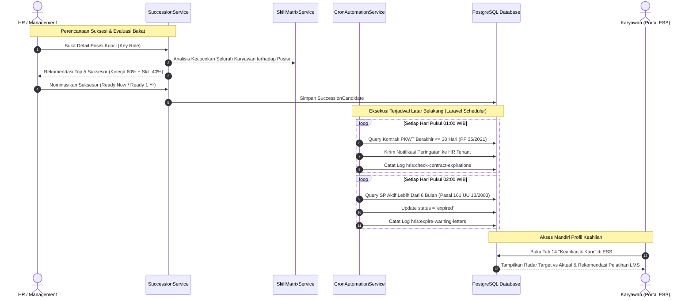

# DOKUMEN IMPLEMENTASI PHASE 9: MATRIKS KOMPETENSI, RENCANA SUKSESI & AUTOMASI CRON

**Platform:** RiHRIS — Multi-Company SaaS HRIS Indonesia  
**Modul:** Kamus Kompetensi, Standar Jabatan, Analisis Kesenjangan (Skill Gap Analysis), Rencana Suksesi Kepemimpinan (Succession Planning & Talent Bench), dan Background Cron Workers Kepatuhan Ketenagakerjaan  
**Status Implementasi:** Production Ready (Completed)

---

## 1. DESKRIPSI & LANDASAN MODUL

Fase 9 melengkapi platform **RiHRIS** dengan pilar manajemen pengembangan talenta strategis (*strategic talent development*) dan automasi tugas berkala (*background worker automation*) sebagaimana diamanatkan pada Section 10.N, 11 (Kepatuhan Regulasi RI), 13 (Notification Center), dan 16 (Scheduler Docker Service):

1. **Kamus Kompetensi & Standar Jabatan (Competency Dictionary & Position Standards)**:
   - Standarisasi kamus keahlian teknis (*hard skills*), keahlian inti/perilaku (*soft skills*), kepemimpinan (*leadership*), dan kepatuhan hukum (*compliance*).
   - Skala kemahiran bertingkat 1 s/d 5 (Level 1: Dasar, Level 2: Menengah, Level 3: Mahir, Level 4: Ahli, Level 5: Pakar).
   - Pemetaan kualifikasi keahlian minimum yang wajib dipenuhi pada setiap jabatan (*Position Skill Requirements*).

2. **Analisis Kesenjangan Kompetensi & Rekomendasi Pelatihan (Skill Gap Matrix)**:
   - Evaluasi kesesuaian keahlian aktual karyawan dengan profil standar jabatan.
   - Perhitungan otomatis Indeks Kecocokan (*Competency Match Percentage*) dan identifikasi keahlian yang mengalami defisit level (*gap*).
   - Rekomendasi otomatis program pelatihan internal dari modul LMS (Phase 4) yang relevan untuk menjembatani kesenjangan kompetensi karyawan.

3. **Rencana Suksesi Posisi Kunci & Talent Pool (Succession Planning & Talent Bench)**:
   - Mitigasi risiko kekosongan jabatan strategis (Direktur, Head of Engineering, HR Manager, Finance Lead).
   - Klasifikasi suksesor berbasis 3 tingkat kesiapan waktu (*readiness tiers*):
     - **Ready Now (Siap Sekarang)**: Karyawan telah memiliki kompetensi dan rekam jejak matang untuk menggantikan seketika.
     - **Ready in 1 Year (Siap 1 Tahun)**: Karyawan berpotensi tinggi yang memerlukan pendampingan intensif selama 1 tahun.
     - **Ready 2+ Years (Jangka Panjang)**: Talenta muda berkemampuan tinggi untuk pembinaan karier jangka panjang.
   - Algoritma rekomendasi suksesor cerdas (*Smart Talent Matching*) yang menggabungkan capaian penilaian kinerja KPI (Phase 4) dan skor kecocokan kompetensi keahlian.

4. **Background Cron Workers Otomatis Kepatuhan Regulasi Indonesia**:
   - `hris:check-contract-expirations`: Memeriksa PKWT yang akan berakhir dalam 30 hari ke depan sesuai PP No. 35/2021 dan mengirimkan notifikasi peringatan kepada HR guna persiapan uang kompensasi PKWT atau perpanjangan kontrak.
   - `hris:expire-warning-letters`: Menghitung masa kedaluwarsa 6 bulan Surat Peringatan (SP1/SP2/SP3) sesuai Pasal 161 UU No. 13/2003 dan otomatis mengeset status menjadi `expired`.
   - `hris:check-probation-expirations`: Memantau masa percobaan PKWTT yang mendekati batas maksimal 3 bulan sesuai Pasal 60 UU Ketenagakerjaan untuk penerbitan SK Pengangkatan Tetap.
   - `hris:process-loan-installments`: Mengidentifikasi angsuran kasbon/pinjaman yang jatuh tempo dalam 7 hari untuk persiapan pemotongan payroll bulanan (PP No. 36/2021).

---

## 2. METODOLOGI & FORMULASI TEKNIS

### A. Formulasi Indeks Kecocokan Kompetensi (Competency Match Percentage)

Untuk setiap standar keahlian $i$ yang disyaratkan pada suatu jabatan:
- $R_i$: Tingkat kemahiran yang disyaratkan (*Required Level*, skala 1-5).
- $A_i$: Tingkat kemahiran aktual karyawan (*Actual Level*, skala 0-5).
- $\text{Gap}_i = \max(0, R_i - A_i)$

Tingkat kecocokan total dihitung dengan rasio perolehan poin aktual terhadap total poin yang disyaratkan:

$$\text{Overall Match Score (\%)} = \left(\frac{\sum_{i=1}^N \min(A_i, R_i)}{\sum_{i=1}^N R_i}\right) \times 100$$

Status kesiapan kompetensi diklasifikasikan sebagai:
- **Siap Suksesi / Promosi**: $\text{Match Score} \ge 80\%$
- **Tahap Perkembangan**: $50\% \le \text{Match Score} < 80\%$
- **Prioritas Upskilling**: $\text{Match Score} < 50\%$

### B. Formulasi Algoritma Rekomendasi Suksesor Berbasis Kinerja & Keahlian

Untuk menentukan suksesor posisi kunci secara objektif, sistem menerapkan pembobotan gabungan:

$$\text{Combined Readiness Score} = (0.6 \times \text{Skor Kinerja KPI}) + (0.4 \times \text{Skor Kecocokan Keahlian Posisi})$$

Kategori kesiapan rekomendasi sistem:
- $\text{Combined Score} \ge 85 \implies \textbf{Ready Now}$
- $70 \le \text{Combined Score} < 85 \implies \textbf{Ready in 1 Year}$
- $\text{Combined Score} < 70 \implies \textbf{Ready 2+ Years}$

---

## 3. ARSITEKTUR ALUR SUKSESI & AUTOMATED CRON

---

## 4. DATABASE SCHEMA PHASE 9

| Nama Tabel | Deskripsi | Relasi Utama |
|---|---|---|
| `skill_categories` | Kategori keahlian (Teknis, Soft Skill, Leadership, Regulasi). | `tenant_id` $\to$ `tenants.id` |
| `skills` | Kamus keahlian dengan kode unik per tenant. | `skill_category_id` $\to$ `skill_categories.id` |
| `position_skill_requirements` | Standar target level kemahiran (1-5) yang wajib dimiliki per jabatan. | `position_id` $\to$ `positions.id`, `skill_id` $\to$ `skills.id` |
| `employee_skills` | Penilaian kemahiran aktual karyawan, data sertifikasi, dan tanggal kedaluwarsa. | `employee_id` $\to$ `employees.id`, `skill_id` $\to$ `skills.id` |
| `succession_plans` | Rencana suksesi untuk jabatan kritis perusahaan dan pemangku saat ini. | `position_id` $\to$ `positions.id`, `current_holder_employee_id` $\to$ `employees.id` |
| `succession_candidates` | Bangku suksesor (*talent bench*) dengan tingkat kesiapan (*readiness tier*). | `succession_plan_id` $\to$ `succession_plans.id`, `candidate_employee_id` $\to$ `employees.id` |
| `cron_execution_logs` | Audit trail riwayat eksekusi tugas terjadwal, jumlah baris data, dan summary. | Standalone system log table |

---

## 5. ARTISAN COMMANDS TERJADWAL

1. **`php artisan hris:check-contract-expirations`**:
   - Jadwal: Setiap hari pukul 01:00 WIB (`dailyAt('01:00')`).
   - Sasaran: Karyawan kontrak PKWT dengan tanggal akhir kontrak $\le 30$ hari ke depan.
   - Regulasi: PP No. 35/2021 Pasal 15-17 (Kewajiban uang kompensasi PKWT).
2. **`php artisan hris:expire-warning-letters`**:
   - Jadwal: Setiap hari pukul 02:00 WIB (`dailyAt('02:00')`).
   - Sasaran: Surat Peringatan aktif dengan masa berlaku $> 6$ bulan.
   - Regulasi: UU No. 13/2003 Pasal 161 ayat (2).
3. **`php artisan hris:check-probation-expirations`**:
   - Jadwal: Setiap hari pukul 03:00 WIB (`dailyAt('03:00')`).
   - Sasaran: Karyawan tetap PKWTT yang memasuki hari ke-75 s.d. ke-90 masa kerja.
   - Regulasi: UU No. 13/2003 Pasal 60 (Masa percobaan kerja paling lama 3 bulan).
4. **`php artisan hris:process-loan-installments`**:
   - Jadwal: Setiap hari pukul 04:00 WIB (`dailyAt('04:00')`).
   - Sasaran: Angsuran kasbon/pinjaman yang jatuh tempo dalam 7 hari ke depan.
   - Regulasi: PP No. 36/2021 (Pemotongan upah berkala).

---

## 6. HASIL PENGUJIAN OTOMATIS (TEST SUITE)

Pengujian komprehensif diimplementasikan pada file `tests/Feature/SkillMatrixAndSuccessionPhase9Test.php` yang mencakup 7 skenario pengujian:
1. `test_competency_dictionary_and_position_requirements_creation`: Validasi pembuatan kategori, pendaftaran keahlian baru, dan penetapan level standar jabatan.
2. `test_employee_skill_assessment_and_gap_analysis`: Verifikasi skoring kemahiran aktual karyawan, perolehan skor kecocokan 85.7%, dan endpoint JSON live gap analysis.
3. `test_skill_matrix_recommends_training_for_gaps`: Verifikasi integrasi modul LMS dalam memberikan rekomendasi pelatihan untuk keahlian yang mengalami defisit.
4. `test_succession_plan_and_candidate_nomination`: Validasi pembentukan rencana suksesi posisi kunci, penunjukan suksesor *Ready Now*, serta metrik bench strength 100%.
5. `test_algorithmic_successor_suggestion_api`: Verifikasi kalkulasi algoritma kecerdasan bakat berbasis gabungan 60% KPI dan 40% kesesuaian keahlian.
6. `test_automated_cron_tasks_execution`: Pengujian langsung eksekusi ke-4 command worker latar belakang dan validasi auto-expiration SP Pasal 161 UU 13/2003.
7. `test_employee_can_view_personal_skills_in_ess_dashboard`: Verifikasi tab ke-14 portal ESS karyawan untuk melihat profil keahlian mandiri.

