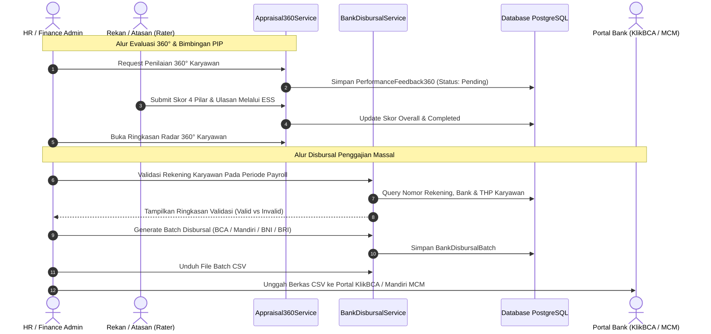

# DOKUMEN IMPLEMENTASI PHASE 10: EVALUASI 360°, PIP, PROFIL KELUARGA/EDUKASI, DISBURSAL BANK & KEPATUHAN UMK/BPJS

**Platform:** RiHRIS — Multi-Company SaaS HRIS Indonesia  
**Modul:** Evaluasi Kinerja 360 Derajat, Program Peningkatan Kinerja (PIP), Profil Mandiri Lengkap (Keluarga, Pendidikan, Pengalaman Kerja, Kontak Darurat, Atasan Langsung), Mass Disbursal Perbankan Nasional (BCA, Mandiri, BNI, BRI), Audit Upah Minimum Regional (UMK PP 51/2023), Laporan Statutori BPJS SIPP Online & e-Dabu, serta Kios Presensi QR Touchless.  
**Status Implementasi:** Production Ready (Completed)

---

## 1. DESKRIPSI & LANDASAN MODUL

Fase 10 menuntaskan seluruh butir spesifikasi teknis dan kepatuhan hukum ketenagakerjaan Indonesia sebagaimana diamanatkan pada Section 10.A (Employee Master), 10.B (Organization Hierarchy), 10.C (Touchless QR Attendance), 10.F (Payroll Disbursal), 10.G (BPJS Compliance Reports), 10.M (Performance 360 & PIP), 11 (Indonesian Compliance), dan 19 (Reporting & Export):

1. **Evaluasi Kinerja 360 Derajat (Multi-Rater 360° Feedback)**:
   - Penilaian holistik dari 4 sudut pandang: Atasan Langsung (*supervisor*), Rekan Sejawat (*peer*), Bawahan Langsung (*subordinate*), dan Swa-Penilaian (*self-review*).
   - Penilaian 4 pilar kompetensi: Nilai Inti & Integritas (*Core Values*), Kepemimpinan (*Leadership*), Kerjasama Tim (*Collaboration*), dan Eksekusi (*Execution & Delivery*).
   - Opsi kerahasiaan identitas (*100% Anonymous Feedback*) guna mendorong transparansi objektif.
   - Dashboard analitik ringkasan radar kompetensi dan umpan balik kualitatif (Kekuatan & Area Pengembangan).

2. **Program Peningkatan Kinerja Terstruktur (Performance Improvement Plan - PIP)**:
   - Mekanisme pendampingan resmi bagi karyawan dengan performa di bawah standar sebelum tindak lanjut sanksi/terminasi.
   - Pencatatan target objektif terukur, rencana aksi (*action plan*), serta log mingguan sesi bimbingan bersama mentor/supervisor.
   - Evaluasi kelulusan resmi: Lulus (*Passed*), Tidak Lulus (*Failed* — tindak lanjut demosi/terminasi Pasal 161 UU 13/2003), atau Diperpanjang (*Extended*).

3. **Profil Mandiri Karyawan Lengkap (Employee 360 Master Data)**:
   - **Data Keluarga & Tanggungan**: Pasangan, anak kandung, orang tua, status tanggungan BPJS Kesehatan dan PTKP pajak (TK/0 s.d. K/3).
   - **Riwayat Pendidikan Formal**: Jenjang SMA/D3/S1/S2/S3, nama universitas, jurusan, tahun kelulusan, dan IPK.
   - **Pengalaman Kerja Terdahulu**: Nama perusahaan sebelumnya, jabatan, masa kerja, dan rekam jejak karir.
   - **Kontak Darurat**: Kerabat darurat terverifikasi dengan nomor telepon dan alamat.
   - **Hierarki Atasan Langsung**: Relasi direct supervisor (`reports_to_id`) untuk alur persetujuan terintegrasi.

4. **Mass Disbursal Penggajian Perbankan Nasional**:
   - Pembuatan batch transfer gaji otomatis dari periode payroll yang telah disetujui (*Approved/Paid*).
   - Generator berkas batch transfer terstandar perbankan korporasi Indonesia:
     - **BCA KlikBCA Bisnis Payroll**: Format CSV terenkripsi sesuai spesifikasi resmi Bank Central Asia.
     - **Mandiri Cash Management (MCM 2.0)**: Format CSV bulk transfer korporat Bank Mandiri.
     - **BNI Direct**: Format berkas mass payment PT Bank Negara Indonesia.
     - **BRI Cash Management System (CMS)**: Format batch transfer PT Bank Rakyat Indonesia.
   - Audit validasi data rekening: Mendeteksi rekening tidak lengkap sebelum berkas diproses perbankan.

5. **Audit Upah Minimum Regional (UMK / UMR PP No. 51 Tahun 2023)**:
   - Kamus standar besaran UMK per kota/kabupaten di seluruh Indonesia (DKI Jakarta, Kota Bekasi, Karawang, Surabaya, Bandung, dll).
   - Engine audit otomatis yang membandingkan gaji pokok karyawan aktif terhadap standar UMK daerah penempatan kantor cabang.
   - Menghitung rasio kepatuhan (*Compliance Rate %*) dan nilai defisit kekurangan upah guna mitigasi risiko sanksi Disnaker.

6. **Pelaporan Statutori BPJS Ketenagakerjaan (SIPP Online) & BPJS Kesehatan (e-Dabu)**:
   - Kompilasi data iuran 5 program BPJS Ketenagakerjaan (JHT, JKK, JKM, JP, JKP) format CSV siap impor ke portal SIPP Online.
   - Kompilasi data iuran 5% BPJS Kesehatan (4% Pemberi Kerja + 1% Pekerja) format CSV portal e-Dabu.

7. **Kios Presensi QR Touchless Berbasis Geofencing**:
   - Tampilan monitor/tablet lobby kantor dengan QR Code dinamis dan jam digital tersinkronisasi (*real-time*).
   - Validasi ganda: Token enkripsi kios per cabang dan verifikasi formula Haversine jarak GPS radius kantor.

---

## 2. METODOLOGI & FORMULASI TEKNIS

### A. Formulasi Indeks Skor Gabungan 360 Derajat

Untuk setiap responden penilai $j \in \{1, \dots, M\}$ yang menilai 4 pilar kompetensi:
- $C_j$: Nilai Inti & Integritas (Skala 1-5)
- $L_j$: Kepemimpinan (Skala 1-5)
- $T_j$: Kerjasama Tim (Skala 1-5)
- $E_j$: Kualitas Eksekusi (Skala 1-5)

$$\text{Skor Penilai}_j = \frac{C_j + L_j + T_j + E_j}{4}$$

$$\text{Indeks Skor 360° Gabungan} = \frac{1}{M} \sum_{j=1}^M \text{Skor Penilai}_j$$

### B. Formulasi Audit Upah Minimum Regional (UMK PP 51/2023)

Berdasarkan PP No. 51 Tahun 2023 dan PP No. 36 Tahun 2021 Pasal 54, upah tetap pekerja tidak boleh lebih rendah dari Upah Minimum Kabupaten/Kota:

$$\text{Status Kepatuhan Karyawan } k = 
\begin{cases} 
\text{Compliant}, & \text{jika } \text{Gaji Pokok}_k \ge \text{UMK}_{\text{Wilayah}} \\
\text{Below Minimum Wage}, & \text{jika } \text{Gaji Pokok}_k < \text{UMK}_{\text{Wilayah}}
\end{cases}$$

$$\text{Defisit Upah}_k = \max(0, \text{UMK}_{\text{Wilayah}} - \text{Gaji Pokok}_k)$$

$$\text{Tingkat Kepatuhan Perusahaan (\%)} = \left(\frac{\text{Jumlah Karyawan Compliant}}{\text{Total Karyawan Aktif}}\right) \times 100$$

### C. Formulasi Jarak Geofence Presensi QR (Formula Haversine)

Untuk memvalidasi bahwa ponsel pemindai QR berada di dalam radius kantor cabang:

$$d = 2R \arcsin\left(\sqrt{\sin^2\left(\frac{\Delta \phi}{2}\right) + \cos(\phi_1)\cos(\phi_2)\sin^2\left(\frac{\Delta \lambda}{2}\right)}\right)$$

Dimana $R = 6.371.000\text{ m}$. Presensi QR diterima jika $d \le (\text{Radius Cabang} + 50\text{ m})$.

---

## 3. ARSITEKTUR ALUR DISBURSAL BANK & EVALUASI 360°

---

## 4. DATABASE SCHEMA PHASE 10

| Nama Tabel | Deskripsi | Relasi Kunci |
|---|---|---|
| `employee_families` | Data keluarga & tanggungan karyawan (pasangan, anak, orang tua, BPJS & PTKP). | `employee_id` $\to$ `employees.id` |
| `employee_educations` | Riwayat pendidikan formal jenjang SMA/D3/S1/S2/S3 beserta universitas & IPK. | `employee_id` $\to$ `employees.id` |
| `employee_employment_histories` | Rekam jejak pengalaman kerja pada perusahaan terdahulu. | `employee_id` $\to$ `employees.id` |
| `employee_emergency_contacts` | Daftar kontak darurat resmi untuk mitigasi insiden kerja. | `employee_id` $\to$ `employees.id` |
| `performance_feedbacks_360` | Penilaian umpan balik 4 pilar kompetensi dari atasan, rekan sejawat, bawahan, dan mandiri. | `subject_employee_id`, `reviewer_employee_id` |
| `performance_improvement_plans` | Program bimbingan PIP terstruktur dengan target terukur & log evaluasi mingguan. | `employee_id`, `supervisor_employee_id` |
| `bank_disbursal_batches` | Batch transfer penggajian massal untuk KlikBCA, Mandiri MCM, BNI Direct, dan BRI CMS. | `payroll_period_id` $\to$ `payroll_periods.id` |
| `regional_minimum_wages` | Kamus standar UMK resmi per kota/kabupaten di Indonesia (PP 51/2023). | `province`, `city_or_regency`, `year` |
| `bpjs_compliance_reports` | Laporan statutori siap impor format BPJS TK SIPP Online & BPJS Kesehatan e-Dabu. | `payroll_period_id` $\to$ `payroll_periods.id` |
| `branch_qr_kiosks` | Kios presensi QR code cabang untuk presensi nirkontak geofencing. | `branch_id` $\to$ `branches.id` |

---

## 5. HASIL PENGUJIAN OTOMATIS (TEST SUITE)

Pengujian komprehensif diimplementasikan pada file `tests/Feature/AdvancedAppraisalsAndCompliancePhase10Test.php` yang mencakup 9 skenario pengujian lengkap:
1. `test_extended_employee_profile_creation_and_relations`: Verifikasi penambahan data keluarga, pendidikan, riwayat kerja terdahulu, dan kontak darurat.
2. `test_employee_reports_to_hierarchical_supervision`: Verifikasi struktur atasan langsung (`reports_to_id`) dan relasi bawahan (`subordinates`).
3. `test_360_degree_feedback_request_and_submission`: Validasi pengiriman permintaan review 360°, pengisian evaluasi 4 pilar, dan kompilasi metrik skor gabungan.
4. `test_performance_improvement_plan_lifecycle`: Pengujian siklus penuh PIP (penerbitan, penambahan log progres mingguan, dan kelulusan resmi).
5. `test_indonesian_bank_disbursal_export_bca_mandiri_bni_bri`: Verifikasi generator batch transfer payroll perbankan nasional (BCA, Mandiri, BNI, BRI).
6. `test_regional_minimum_wage_umk_compliance_audit`: Validasi engine audit kepatuhan UMK PP 51/2023, deteksi karyawan di bawah UMK, dan kalkulasi defisit.
7. `test_bpjs_tk_sipp_and_kes_edabu_report_generation`: Validasi kompilasi berkas statutori BPJS Ketenagakerjaan (SIPP Online) dan BPJS Kesehatan (e-Dabu).
8. `test_branch_qr_kiosk_generation_and_touchless_clock_in`: Pengujian kios presensi QR, token refresh, dan presensi nirkontak berbasis geofencing GPS.
9. `test_employee_can_access_phase10_features_in_ess`: Verifikasi portal ESS karyawan untuk pengisian review 360°, pemantauan PIP aktif, dan pendaftaran mandiri keluarga/edukasi.
