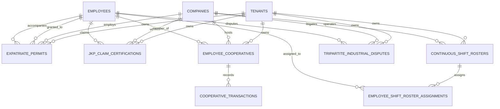

# DOKUMEN IMPLEMENTASI PHASE 16: TKA & RPTKA KEMNAKER (PP NO. 34/2021), KLAIM JKP BPJS KETENAGAKERJAAN (PP NO. 37/2021), KOPERASI KARYAWAN & SIMPAN PINJAM (UU NO. 25/1992), CONTINUOUS SHIFT ROSTER 24/7 (KEPMENAKERTRANS NO. 233/2003), DAN MEDIASI TRIPARTIT PPHI (UU NO. 2/2004)

**Platform:** RiHRIS — Multi-Company SaaS HRIS Platform Indonesia  
**Modul:**  
1. Pengawasan Tenaga Kerja Asing (TKA) & Pengesahan RPTKA Kemnaker (PP No. 34/2021, DKPTKA USD 100/bulan, TKI Pendamping & Blokir Jabatan Personalia)  
2. Sertifikasi Manfaat Jaminan Kehilangan Pekerjaan (JKP BPJS Ketenagakerjaan & PP No. 37/2021, Plafon Upah Rp 5 Juta, Manfaat 45% & 25%, Integrasi SiapKerja)  
3. Koperasi Karyawan (KOPKAR) & Simpan Pinjam Kesejahteraan Pekerja (UU No. 25/1992 jo. UU No. 13/2003 Pasal 100 & Potong Gaji Otomatis)  
4. Continuous Shift Roster Sektor Khusus 24/7 (Kepmenakertrans No. KEP-233/MEN/2003, Pola 3 Shift 4 Grup Kontinu, Tunjangan Shift Malam & On-Call Standby)  
5. Mediasi Tripartit & Penyelesaian Perselisihan Hubungan Industrial / PPHI (UU No. 2/2004, Anjuran Tertulis Mediator, Perjanjian Bersama PB vs Gugatan PHI)  
**Status Implementasi:** Production Ready (Completed)

---

## 1. DESKRIPSI & LANDASAN HUKUM INDONESIA

Fase 16 memperluas tata kelola kepatuhan statutori dan operasional tingkat enterprise pada lima pilar strategis ketenagakerjaan Indonesia:

### 1.1 Pengawasan TKA & RPTKA Kemnaker (PP No. 34 Tahun 2021 & Permenaker No. 8/2021)
- **Landasan Hukum**:
  - **Peraturan Pemerintah No. 34 Tahun 2021** tentang Penggunaan Tenaga Kerja Asing.
  - **Permenaker No. 8 Tahun 2021** tentang Peraturan Pelaksanaan PP No. 34/2021.
  - **UU No. 13 Tahun 2003 Pasal 46** jo. **Kepmenaker No. 349 Tahun 2019** tentang Jabatan-Jabatan Tertentu yang Dilarang Diduduki Tenaga Kerja Asing.
- **Ketentuan Kepatuhan Yuridis**:
  1. **Pengesahan RPTKA**: Setiap pemberi kerja yang mempekerjakan TKA wajib memiliki Rencana Penggunaan Tenaga Kerja Asing (RPTKA) yang disahkan oleh Menteri Ketenagakerjaan.
  2. **Larangan Jabatan Personalia (HR Restriction)**: TKA dilarang keras memangku jabatan yang membidangi personalia, hubungan industrial, atau sumber daya manusia (misalnya *HR Director*, *Personnel Specialist*, *Industrial Relations Lead*). Sistem memvalidasi dan melempar *InvalidArgumentException* secara otomatis jika posisi terlarang didaftarkan.
  3. **Penunjukan TKI Pendamping**: Pemberi kerja wajib menunjuk tenaga kerja WNI sebagai pendamping TKA yang dipekerjakan untuk alih teknologi dan keahlian (*transfer of technology and skills*).
  4. **Dana Kompensasi Penggunaan TKA (DKPTKA)**: Pembayaran retribusi PNBP sebesar **USD 100 per bulan per TKA** ke kas negara melalui sistem NTPN Kemnaker.
  5. **Early Warning Expiry**: Deteksi dini masa berlaku RPTKA dan ITAS/VITAS pada H-60 hari guna mencegah sanksi overstay atau pencabutan izin kerja.

---

### 1.2 Sertifikasi Klaim JKP BPJS Ketenagakerjaan (PP No. 37 Tahun 2021)
- **Landasan Hukum**:
  - **Peraturan Pemerintah No. 37 Tahun 2021** tentang Penyelenggaraan Program Jaminan Kehilangan Pekerjaan (JKP).
  - **Permenaker No. 15 Tahun 2021** tentang Tata Cara Pemberian Manfaat JKP.
- **Kriteria Kelayakan & Formula Manfaat Tunai**:
  1. **Plafon Upah Acuan (Wage Cap)**: Batas atas upah yang digunakan sebagai dasar perhitungan manfaat uang tunai adalah **Rp 5.000.000,00** per bulan (Pasal 21 ayat 1).
  2. **Formula Manfaat Uang Tunai 6 Bulan**:
     - **Bulan ke-1 s/d ke-3**: $45\% \times \min(\text{Upah}, \text{Rp } 5.000.000)$ $\rightarrow$ Maksimal **Rp 2.250.000 / bulan**.
     - **Bulan ke-4 s/d ke-6**: $25\% \times \min(\text{Upah}, \text{Rp } 5.000.000)$ $\rightarrow$ Maksimal **Rp 1.250.000 / bulan**.
     - **Total Maksimal Akumulasi Manfaat Tunai**: **Rp 10.500.000,00** (setara $2,1 \times$ plafon upah).
  3. **Syarat Masa Iur (Contribution Tenure)**: Pekerja memiliki masa iur paling sedikit 12 bulan dalam kurun waktu 24 bulan dan telah membayar iuran berturut-turut minimal 6 bulan sebelum terjadi PHK.
  4. **Pengecualian Mutlak Pengunduran Diri (Resignation Exclusion)**: Sesuai Pasal 19 ayat 3 PP 37/2021, pekerja yang mengundurkan diri secara sukarela (*voluntary resignation*), pensiun, meninggal dunia, atau habis kontrak PKWT demi hukum **tidak berhak** atas manfaat program JKP. Sistem secara tegas memblokir pengajuan JKP untuk alasan pemutusan hubungan kerja di luar kriteria statutory (efisiensi, pailit, force majeure, merger).
  5. **Dokumentasi SiapKerja**: Generator surat rekomendasi dan tanda terima pelaporan PHK ke portal Kemnaker (`siapkerja.kemnaker.go.id`).

---

### 1.3 Koperasi Karyawan & Simpan Pinjam (UU No. 25/1992 jo. UU No. 13/2003 Pasal 100)
- **Landasan Hukum**:
  - **UU No. 25 Tahun 1992** tentang Perkoperasian.
  - **UU No. 13 Tahun 2003 Pasal 100** tentang Penyediaan Fasilitas Kesejahteraan Karyawan (Koperasi Pekerja).
- **Fitur Tata Kelola Koperasi Karyawan (KOPKAR)**:
  1. **Simpanan Pokok, Simpanan Wajib & Simpanan Sukarela**:
     - *Simpanan Pokok*: Dibayarkan satu kali saat resmi terdaftar sebagai anggota koperasi.
     - *Simpanan Wajib*: Iuran rutin bulanan yang dipotong langsung melalui sistem payroll (*payroll deduction*).
     - *Simpanan Sukarela*: Simpanan fleksibel yang dapat disetor maupun ditarik sewaktu-waktu.
  2. **Pinjaman Lunak & Angsuran Payroll**:
     - Pencairan pinjaman produktif/konsumtif karyawan dengan pencatatan saldo utang berjalan (*active loan balance*).
     - Pemotongan angsuran berkala otomatis saat proses closing penggajian bulanan.
  3. **Penyaluran Dana Sosial Kesejahteraan & Dividen SHU**:
     - Pembagian Sisa Hasil Usaha (SHU) tahunan secara proporsional berdasarkan kontribusi modal dan transaksi anggota.

---

### 1.4 Continuous Shift Roster 24/7 (Kepmenakertrans No. KEP-233/MEN/2003)
- **Landasan Hukum**:
  - **Kepmenakertrans No. KEP-233/MEN/2003** tentang Jenis dan Sifat Pekerjaan yang Dijalankan Secara Terus Menerus.
  - Sektor yang diizinkan beroperasi 24 jam non-stop: Layanan Teknologi Informasi & Server SaaS, Telekomunikasi, Pusat Operasi Keamanan Jaringan (SOC/NOC), Rumah Sakit, Utilitas Energi, dan Manufaktur Kontinu.
- **Mekanisme Pola Rotasi 3 Shift 4 Grup**:
  1. **Siklus 28 Hari Kalender**:
     - Terdiri dari 21 hari kerja efektif dan 7 hari istirahat mingguan bergilir (*rest days*).
     - 4 regu/grup kerja independen (Grup A, Grup B, Grup C, Grup D).
     - Rotasi shift: Shift 1 Pagi (07:00 - 15:00), Shift 2 Sore (15:00 - 23:00), Shift 3 Malam (23:00 - 07:00), dan Shift Libur (OFF).
  2. **Tunjangan Khusus Statutori & Perusahaan**:
     - *Tunjangan Shift Malam (Night Shift Allowance)*: Kompensasi ekstra atas jam kerja biologis malam hari sesuai kesepakatan PKB/PP.
     - *Tunjangan Siaga (Standby / On-Call Allowance)*: Kompensasi kesiapan personil respon insiden kritis di luar jam kerja normal.
  3. **Kalkulator Tunjangan Otomatis**: Menghitung akumulasi kompensasi shift malam dan siaga untuk disalurkan ke komponen penggajian bulanan.

---

### 1.5 Mediasi Tripartit & PPHI (UU No. 2 Tahun 2004)
- **Landasan Hukum**:
  - **UU No. 2 Tahun 2004** tentang Penyelesaian Perselisihan Hubungan Industrial (PPHI).
- **Hierarki Penyelesaian Perselisihan**:
  1. **Klasifikasi 4 Jenis Perselisihan**:
     - *Perselisihan Hak*: Tidak dipenuhinya hak normatif pekerja (upah UMK, lembur, cuti, BPJS).
     - *Perselisihan Kepentingan*: Perbedaan pendapat mengenai perubahan syarat kerja atau klausul PP/PKB.
     - *Perselisihan Pemutusan Hubungan Kerja (PHK)*: Ketidaksepakatan pengakhiran hubungan kerja dan besaran pesangon.
     - *Perselisihan Antar Serikat Pekerja*: Konflik antar serikat pekerja dalam satu perusahaan mengenai keterwakilan keanggotaan.
  2. **Penyelesaian Musyawarah Mediasi Tripartit**:
     - Jika perundingan bipartit gagal, salah satu atau kedua belah pihak mencatatkan perselisihan ke Dinas Tenaga Kerja setempat.
     - Mediator Hubungan Industrial Disnaker mengeluarkan **Anjuran Tertulis** (*Mediator's Written Recommendation*).
  3. **Dua Cabang Keputusan**:
     - **Kedua Belah Pihak Menyetujui Anjuran**: Dibuat **Perjanjian Bersama (PB)** yang ditandatangani para pihak dan didaftarkan pada Pengadilan Hubungan Industrial (PHI) pada Pengadilan Negeri setempat untuk memperoleh Akta Bukti Pendaftaran berkekuatan hukum eksekusi.
     - **Salah Satu atau Kedua Belah Pihak Menolak Anjuran**: Salah satu pihak dapat mengajukan gugatan perselisihan ke Pengadilan Hubungan Industrial (PHI).
  4. **Pencatatan Dokumen Resmi**: Generator ringkasan dossier perkara mediasi tripartit lengkap dengan kronologis, anjuran mediator, dan status pendaftaran akta PB.

---

## 2. ARSITEKTUR DATABASE & STRUKTUR TABEL

Migration: `database/migrations/2026_01_16_000001_create_phase16_tka_jkp_koperasi_roster_and_pphi_tables.php`



### 2.1 Model & Relasi
1. [`ExpatriatePermit`](file:///Users/legacygandawijaya/Documents/hris-php/app/Models/ExpatriatePermit.php) $\rightarrow$ Relasi ke `Company`, `Employee` (TKA), dan `companionEmployee` (TKI WNI Pendamping).
2. [`JkpClaimCertification`](file:///Users/legacygandawijaya/Documents/hris-php/app/Models/JkpClaimCertification.php) $\rightarrow$ Relasi ke `Company`, `Employee`.
3. [`EmployeeCooperative`](file:///Users/legacygandawijaya/Documents/hris-php/app/Models/EmployeeCooperative.php) $\rightarrow$ Relasi ke `Company`, `Employee`, dan `hasMany(CooperativeTransaction)`.
4. [`CooperativeTransaction`](file:///Users/legacygandawijaya/Documents/hris-php/app/Models/CooperativeTransaction.php) $\rightarrow$ Relasi ke `EmployeeCooperative`.
5. [`ContinuousShiftRoster`](file:///Users/legacygandawijaya/Documents/hris-php/app/Models/ContinuousShiftRoster.php) $\rightarrow$ Relasi ke `Company`, `Department`, dan `hasMany(EmployeeShiftRosterAssignment)`.
6. [`EmployeeShiftRosterAssignment`](file:///Users/legacygandawijaya/Documents/hris-php/app/Models/EmployeeShiftRosterAssignment.php) $\rightarrow$ Relasi ke `ContinuousShiftRoster`, `Employee`.
7. [`TripartiteIndustrialDispute`](file:///Users/legacygandawijaya/Documents/hris-php/app/Models/TripartiteIndustrialDispute.php) $\rightarrow$ Relasi ke `Company`, `Employee`, `BipartiteMeeting`.

---

## 3. LAPISAN SERVICE (BUSINESS LOGIC)

1. [`ExpatriatePermitService`](file:///Users/legacygandawijaya/Documents/hris-php/app/Services/Compliance/ExpatriatePermitService.php):
   - `registerPermit()`: Validasi larangan jabatan personalia (Pasal 46 UU 13/2003 jo. Kepmenaker 349/2019), penunjukan WNI pendamping, dan setoran DKPTKA USD 100/bulan.
   - `checkExpiringPermits()`: Deteksi otomatis RPTKA/ITAS jatuh tempo dalam rentang 60 hari.
   - `generateKemnakerReportPayload()`: Ekspor audit pelaporan tenaga kerja asing ke portal kemnaker.
2. [`JkpClaimService`](file:///Users/legacygandawijaya/Documents/hris-php/app/Services/Compliance/JkpClaimService.php):
   - `certifyClaim()`: Validasi masa iur 6 bulan berturut-turut, penolakan mutlak pengunduran diri sukarela (Pasal 19 ayat 3 PP 37/2021), plafon upah Rp 5.000.000, kalkulasi manfaat 45% (bulan 1-3) dan 25% (bulan 4-6).
   - `generateDisnakerReportingPayload()`: Pembuatan dossier rekomendasi pencairan tunjangan tunai JKP di BPJS Ketenagakerjaan.
3. [`EmployeeCooperativeService`](file:///Users/legacygandawijaya/Documents/hris-php/app/Services/Financial/EmployeeCooperativeService.php):
   - `registerMember()`: Pendaftaran anggota, pembayaran simpanan pokok awal.
   - `processMonthlyDeduction()`: Pemotongan otomatis simpanan wajib dan sukarela via payroll.
   - `recordTransaction()`: Mutasi pinjaman kredit karyawan, angsuran berjalan, dan penyaluran dana sosial.
4. [`ContinuousShiftRosterService`](file:///Users/legacygandawijaya/Documents/hris-php/app/Services/Attendance/ContinuousShiftRosterService.php):
   - `createRoster()`: Konfigurasi pola rotasi kontinu 24/7 (3 shift 4 grup).
   - `assignEmployeeToGroup()`: Penugasan grup A/B/C/D karyawan.
   - `calculateShiftAllowances()`: Kalkulasi tunjangan shift malam dan tunjangan on-call standby.
5. [`IndustrialDisputeService`](file:///Users/legacygandawijaya/Documents/hris-php/app/Services/Relations/IndustrialDisputeService.php):
   - `recordDispute()`: Pencatatan 4 jenis perselisihan hubungan industrial (UU No. 2/2004).
   - `recordMediatorRecommendation()`: Dokumentasi anjuran tertulis mediator Disnaker.
   - `respondToRecommendation()`: Penentuan hasil kesepakatan (Perjanjian Bersama PB vs eskalasi gugatan ke PHI).
   - `generateDisputeFilingDocket()`: Pembentukan dokumen dossier perkara PPHI.

---

## 4. LAPISAN CONTROLLER, ROUTE & BLADE VIEWS

### 4.1 Routes (`routes/web.php`)
```php
// Phase 16: Expatriate Work Permits & RPTKA (PP 34/2021)
Route::resource('expatriates', ExpatriatePermitController::class);
Route::get('expatriates-export-kemnaker', [ExpatriatePermitController::class, 'exportKemnaker'])->name('expatriates.export');

// Phase 16: Jaminan Kehilangan Pekerjaan (JKP PP 37/2021)
Route::resource('jkp', JkpClaimController::class);
Route::get('jkp/{jkp}/print-recommendation', [JkpClaimController::class, 'printRecommendation'])->name('jkp.print');

// Phase 16: Employee Cooperative & Savings (UU 25/1992)
Route::resource('cooperative', EmployeeCooperativeController::class);
Route::post('cooperative/{cooperative}/transaction', [EmployeeCooperativeController::class, 'recordTransaction'])->name('cooperative.transaction');
Route::post('cooperative/{cooperative}/process-deduction', [EmployeeCooperativeController::class, 'processDeduction'])->name('cooperative.deduction');

// Phase 16: Continuous 24/7 Shift Rosters (Kepmenakertrans 233/2003)
Route::resource('rosters', ContinuousShiftRosterController::class);
Route::post('rosters/{roster}/assign', [ContinuousShiftRosterController::class, 'assignEmployee'])->name('rosters.assign');

// Phase 16: Tripartite Industrial Disputes & PPHI (UU 2/2004)
Route::resource('disputes', TripartiteDisputeController::class);
Route::post('disputes/{dispute}/recommendation', [TripartiteDisputeController::class, 'recordRecommendation'])->name('disputes.recommendation');
Route::post('disputes/{dispute}/respond', [TripartiteDisputeController::class, 'respondRecommendation'])->name('disputes.respond');
Route::get('disputes/{dispute}/print-docket', [TripartiteDisputeController::class, 'printDocket'])->name('disputes.print');
```

### 4.2 Views Blade
1. `resources/views/company/expatriates/index.blade.php`: Tabel TKA, status RPTKA, pendamping WNI, bukti bayar DKPTKA.
2. `resources/views/company/expatriates/show.blade.php`: Detail izin kerja, status alih teknologi, paspor & ITAS.
3. `resources/views/company/jkp/index.blade.php`: Daftar sertifikasi JKP, alasan PHK, perhitungan manfaat tunai.
4. `resources/views/company/jkp/show.blade.php`: Rincian bulan 1-3 & 4-6, kode lacak SiapKerja Kemnaker.
5. `resources/views/company/jkp/print_recommendation.blade.php`: Format cetak resmi surat rekomendasi JKP ke BPJS Ketenagakerjaan.
6. `resources/views/company/cooperative/index.blade.php`: Manajemen KOPKAR, simpanan pokok/wajib/sukarela, saldo pinjaman.
7. `resources/views/company/rosters/index.blade.php`: Konfigurasi rotasi 3 shift 4 grup 24/7, tarif tunjangan shift malam & siaga.
8. `resources/views/company/disputes/index.blade.php`: Daftar mediasi tripartit PPHI Disnaker, anjuran mediator, status PB/PHI.
9. `resources/views/company/disputes/print_dispute.blade.php`: Dossier cetak berkas perkara PPHI dan akta pendaftaran PB.

---

## 5. MATRIKS AUTOMATED FEATURE TESTS

Pengujian komprehensif tertuang pada file [`tests/Feature/AdvancedEnterpriseCompliancePhase16Test.php`](file:///Users/legacygandawijaya/Documents/hris-php/tests/Feature/AdvancedEnterpriseCompliancePhase16Test.php) dengan 12 skenario pengujian:

| No | Nama Test Method | Skenario Pengujian Statutori |
|---|---|---|
| 1 | `test_expatriate_permit_registration_under_pp_34_2021` | Registrasi RPTKA TKA lengkap dengan penunjukan TKI pendamping dan retribusi DKPTKA USD 100/bulan |
| 2 | `test_expatriate_permit_blocks_hr_positions_under_pasal_46_uu_13_2003` | Verifikasi blokir mutlak pendaftaran TKA pada jabatan personalia/SDM (Pasal 46 UU 13/2003) |
| 3 | `test_expatriate_permit_expiry_detection` | Deteksi dini otomatis masa berlaku izin RPTKA H-60 hari menjadi status `expiring_soon` |
| 4 | `test_jkp_claim_benefit_calculation_under_pp_37_2021` | Perhitungan manfaat tunai JKP: plafon Rp 5.000.000, bulan 1-3 (45% = Rp 2.250.000), bulan 4-6 (25% = Rp 1.250.000), total Rp 10.500.000 |
| 5 | `test_jkp_claim_rejects_voluntary_resignation_under_pasal_19_pp_37_2021` | Penolakan klaim JKP untuk karyawan mengundurkan diri sukarela (Pasal 19 ayat 3 PP 37/2021) |
| 6 | `test_jkp_disnaker_reporting_payload_generation` | Pembentukan payload sertifikasi JKP ke portal Disnaker & SiapKerja Kemnaker |
| 7 | `test_employee_cooperative_registration_and_principal_savings` | Pendaftaran anggota koperasi KOPKAR dan pencatatan transaksi simpanan pokok (UU 25/1992) |
| 8 | `test_cooperative_monthly_payroll_deduction_and_savings_accumulation` | Pemotongan otomatis simpanan wajib dan sukarela via payroll dan kenaikan saldo tabungan |
| 9 | `test_cooperative_loan_disbursement_and_repayment_balance` | Pencairan pinjaman lunak karyawan dan pemotongan angsuran berkala yang memperbarui sisa saldo utang |
| 10 | `test_continuous_shift_roster_allowances_under_kepmenaker_233_2003` | Pembuatan pola 3 shift 4 grup 24/7 dan kalkulasi tunjangan shift malam & standby on-call |
| 11 | `test_tripartite_industrial_dispute_and_perjanjian_bersama_under_uu_2_2004` | Mediasi tripartit Disnaker, anjuran tertulis mediator, dan pencapaian Perjanjian Bersama (PB) inkracht |
| 12 | `test_tripartite_dispute_rejection_escalates_to_phi_court` | Penolakan anjuran tertulis mediator yang secara prosedural mengeskalasi perkara ke Gugatan PHI Pengadilan Negeri |

---

## 6. INTEGRASI SEEDER DEMO

File [`database/seeders/DemoCompanySeeder.php`](file:///Users/legacygandawijaya/Documents/hris-php/database/seeders/DemoCompanySeeder.php) telah diperbarui dengan data demo komprehensif:
1. **TKA John Smith**: *Chief Technical Architect & Cloud Advisor* (RPTKA/2026/01/0089 disahkan Kemnaker, paspor GBR, ITAS valid, DKPTKA USD 100/bulan terbayar, TKI pendamping Budi Santoso).
2. **Klaim JKP Ani Widyastuti**: Pengakhiran kerja karena efisiensi restrukturisasi, 8 bulan iur berturut-turut, plafon Rp 5.000.000 dengan simulasi tunjangan Rp 10.500.000 dan kode lacak SiapKerja.
3. **Koperasi Karyawan Sejahtera**: Budi Santoso sebagai anggota aktif (No. KOPKAR-2026-0001), simpanan pokok Rp 500.000, simpanan wajib Rp 100.000/bulan, simpanan sukarela Rp 50.000/bulan, total saldo Rp 3.500.000, dan pinjaman berjalan Rp 4.500.000.
4. **Continuous Roster 24/7 Ops & NOC**: Pola rotasi 3 shift 4 grup (siklus 28 hari, 21 hari kerja, 7 hari libur, tunjangan malam Rp 65.000/shift, tunjangan siaga Rp 85.000/hari), penugasan Budi Santoso di Grup A.
5. **Mediasi Tripartit PPHI**: Kasus No. `PHI-CASE/2026/0001`, mediator Sudin Tenaga Kerja Jakarta Selatan Dra. Siti Nurhaliza M.H., anjuran tertulis disepakati kedua pihak menjadi Perjanjian Bersama (PB) No. `PB-PHI-PN-JKT-PST/2026/041`.
