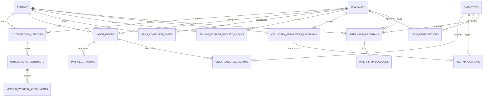

# DOKUMEN IMPLEMENTASI PHASE 17: ALIH DAYA (OUTSOURCING PP NO. 35/2021 & TUPE), PERJANJIAN KERJA BERSAMA (PKB UU NO. 21/2000), SATGAS PPKS & RAMAH PEREMPUAN (KEPMENAKER NO. 88/2023), PENSIUN DINI (VSS) & DPLK (UU NO. 4/2023 P2SK), SERTA PEMAGANGAN DALAM NEGERI (PERMENAKER NO. 6/2020)

**Platform:** RiHRIS — Multi-Company SaaS HRIS Platform Indonesia  
**Modul:**  
1. Tata Kelola Alih Daya / Outsourcing Berbadan Hukum PT (PP No. 35/2021 BAB IV, NIB OSS Kemnaker, Verifikasi Upah UMK & BPJS, serta Jaminan TUPE Putusan MK No. 27/PUU-IX/2011)  
2. Serikat Pekerja / Buruh & Perundingan Perjanjian Kerja Bersama (PKB) (UU No. 21/2000, Batas Kuota Keterwakilan >50% Pasal 119 UU 13/2003, Batas 30 Hari Kerja Permenaker No. 28/2014, dan Check-Off System)  
3. Satgas Pencegahan & Penanganan Kekerasan Seksual (PPKS) & Fasilitas Ramah Perempuan (Kepmenaker No. 88/2023, UU TPKS No. 12/2022, Ruang Laktasi Permenkes 15/2013, dan Angkutan Jemputan Shift Malam Pasal 76 UU 13/2003)  
4. Program Pensiun Dini Sukarela (Voluntary Separation Scheme / VSS Golden Handshake) & Program DPLK (UU No. 4/2023 tentang P2SK & PP 35/2021)  
5. Penyelenggaraan Pemagangan Terstruktur Dalam Negeri (Permenaker No. 6/2020, Perjanjian Pemagangan Tertulis, Batas Kuota 20%, Uang Saku Harian, Jaminan BPJS BPU, dan E-Sertifikat Terverifikasi)  
**Status Implementasi:** Production Ready (Completed)

---

## 1. DESKRIPSI & LANDASAN HUKUM INDONESIA

Fase 17 mengokohkan arsitektur enterprise RiHRIS pada domain kemitraan penyedia jasa pekerja eksternal, perundingan hubungan industrial kolektif serikat buruh, ruang kerja inklusif & aman bagi perempuan, rasionalisasi tenaga kerja sukarela yang humanis, dan akselerasi regenerasi keahlian vokasi melalui pemagangan nasional:

### 1.1 Alih Daya / Outsourcing & Jaminan TUPE (PP No. 35/2021 BAB IV & Putusan MK No. 27/PUU-IX/2011)
- **Dasar Hukum**:
  - **Peraturan Pemerintah No. 35 Tahun 2021 BAB IV** (Pasal 18 s/d 20) tentang Hubungan Kerja, Alih Daya, Waktu Kerja dan Waktu Istirahat, dan PHK.
  - **Putusan Mahkamah Konstitusi No. 27/PUU-IX/2011** tentang jaminan perlindungan hak pekerja alih daya.
- **Kepatuhan Yuridis**:
  1. **Legalitas Perusahaan Penyedia Jasa**: Wajib berbentuk Perseroan Terbatas (PT) berbadan hukum dan memiliki Nomor Induk Berusaha (NIB) berbasis risiko dari OSS Kemnaker.
  2. **Prinsip TUPE (*Transfer of Undertakings Protection of Employment*)**: Menjamin kelangsungan bekerja bagi pekerja/buruh alih daya bila terjadi pergantian perusahaan penyedia jasa sepanjang objek pekerjaan yang diperjanjikan tetap ada.
  3. **Audit Kepatuhan Hak Normatif**: Sistem memastikan setiap pekerja vendor menerima upah sekurang-kurangnya sebesar UMK wilayah penempatan dan telah terdaftar aktif dalam BPJS Ketenagakerjaan serta BPJS Kesehatan.
  4. **Struktur Penagihan & Management Fee**: Penagihan transparan berbasis upah pokok ditambah persentase biaya manajemen (*Management Fee* standar industri $8\% - 15\%$).

---

### 1.2 Serikat Pekerja & Perundingan PKB (UU No. 21/2000 jo. Permenaker No. 28/2014)
- **Dasar Hukum**:
  - **UU No. 21 Tahun 2000** tentang Serikat Pekerja / Serikat Buruh.
  - **UU No. 13 Tahun 2003 Pasal 116 s/d 135** tentang Perjanjian Kerja Bersama.
  - **Permenaker No. 28 Tahun 2014** tentang Tata Cara Pembuatan dan Pengesahan Peraturan Perusahaan serta Pembuatan dan Pendaftaran Perjanjian Kerja Bersama.
- **Ketentuan Prosedural**:
  1. **Ambang Batas Keterwakilan (>50%)**: Sesuai Pasal 119 UU 13/2003, serikat pekerja berhak mewakili pekerja dalam perundingan PKB bila memiliki lebih dari $50\%$ anggota dari total seluruh pekerja di perusahaan. Jika kurang dari $50\%$, serikat dapat berkoalisi hingga mencapai $>50\%$ atau melalui pemungutan suara (voting).
  2. **Batas Waktu Perundingan**: Maksimal **30 (tiga puluh) hari kerja** terhitung sejak perundingan pertama dibuka (Pasal 24 Permenaker 28/2014).
  3. **Masa Berlaku PKB**: Paling lama **2 (dua) tahun** dan didaftarkan pada Dinas Ketenagakerjaan untuk mendapatkan SK Pengesahan.
  4. **Check-off System**: Pemotongan iuran bulanan anggota serikat pekerja langsung melalui payroll dengan syarat mutlak adanya Surat Kuasa Tertulis dari pekerja bersangkutan.

---

### 1.3 Satgas PPKS & Fasilitas Kesejahteraan Ramah Perempuan (Kepmenaker No. 88/2023 & UU TPKS 12/2022)
- **Dasar Hukum**:
  - **Kepmenaker No. 88 Tahun 2023** tentang Pedoman Pencegahan dan Penanganan Kekerasan Seksual di Tempat Kerja.
  - **UU No. 12 Tahun 2022** tentang Tindak Pidana Kekerasan Seksual (UU TPKS).
  - **UU No. 13 Tahun 2003 Pasal 76** tentang Perlindungan Tenaga Kerja Perempuan.
  - **Permenkes No. 15 Tahun 2013** tentang Tata Cara Penyediaan Fasilitas Khusus Menyusui dan/atau Memerah Air Susu Ibu.
- **Kewajiban Pengusaha & Sistem Keamanan**:
  1. **Satuan Tugas (Satgas) PPKS**: Membentuk komite/satgas internal dengan komposisi perwakilan manajemen dan pekerja.
  2. **Kanal Pengaduan Rahasia (Confidential Channel)**: Penyampaian aduan dengan opsi penyamaran identitas (*pseudonym/anonymous*) dan klausul perlindungan korban dari tindakan pembalasan/retaliasi (*zero retaliation*).
  3. **Fasilitas Ruang Laktasi**: Penyediaan ruang menyusui/memerah ASI yang privat, higienis, dilengkapi wastafel dan lemari pendingin ASI.
  4. **Angkutan Antar-Jemput Shift Malam**: Pengusaha yang mempekerjakan perempuan antara pukul **23.00 s/d 05.00** wajib menyediakan angkutan antar-jemput pulang-pergi dan makanan/minuman bergizi (Pasal 76 ayat 3 dan 4 UU 13/2003).

---

### 1.4 Voluntary Separation Scheme (VSS) & DPLK (UU No. 4/2023 P2SK)
- **Dasar Hukum**:
  - **UU No. 4 Tahun 2023** tentang Pengembangan dan Penguatan Sektor Keuangan (UU P2SK).
  - **PP No. 35 Tahun 2021** (Formula Kompensasi PHK).
- **Mekanisme Pensiun Dini Sukarela**:
  1. **Paket Pesangon Berlipat (*Golden Handshake*)**: Insentif finansial di atas pesangon normatif PP 35/2021 dengan faktor pengali ($1.5\times$ s/d $2.5\times$ PMTK) ditambah bonus tali asih tunai.
  2. **Persetujuan Bersama**: Dilakukan secara murni sukarela tanpa paksaan, ditutup dengan penetapan tanggal efektif kompensasi dan penerbitan hak-hak pasca-kerja.
  3. **Program DPLK Terintegrasi**: Pengelolaan iuran pensiun lembaga keuangan yang diatur dalam UU P2SK (misal $5\%$ kontribusi perusahaan dan $2.5\%$ kontribusi pekerja) untuk proteksi kesejahteraan hari tua.

---

### 1.5 Pemagangan Terstruktur Dalam Negeri (Permenaker No. 6/2020)
- **Dasar Hukum**:
  - **Permenaker No. 6 Tahun 2020** tentang Penyelenggaraan Pemagangan di Dalam Negeri.
- **Batasan Statutori**:
  1. **Perjanjian Pemagangan Tertulis**: Hubungan hukum adalah pemagangan (bukan hubungan kerja/buruh), memuat hak, kewajiban, dan kurikulum keahlian (Pasal 9).
  2. **Batas Waktu Maksimal**: Durasi pemagangan paling lama **1 (satu) tahun** kalender (Pasal 5).
  3. **Batas Kuota Pemagang (Maksimal 20%)**: Jumlah peserta pemagangan di perusahaan paling banyak **20%** dari total jumlah pekerja aktif (Pasal 10).
  4. **Hak Pemagang**: Memperoleh uang saku harian (transport & makan), perlindungan K3, dan wajib diikutsertakan dalam program **BPJS Ketenagakerjaan Bukan Penerima Upah (BPU)** untuk jaminan kecelakaan kerja (JKK) dan jaminan kematian (JKM) (Pasal 13).
  5. **Logbook & Sertifikat**: Pencatatan aktivitas harian yang diverifikasi mentor pembimbing serta penerbitan Sertifikat Pemagangan resmi (Pasal 18).

---

## 2. ARSITEKTUR DATABASE & TABEL (PHASE 17)

Migration: `database/migrations/2026_01_17_000001_create_phase17_outsourcing_pkb_ppks_vss_and_internship_tables.php`

---

## 3. LAPISAN SERVICE LAYER

1. [`OutsourcingComplianceService`](file:///Users/legacygandawijaya/Documents/hris-php/app/Services/Compliance/OutsourcingComplianceService.php):
   - `registerVendor()`: Registrasi rekanan vendor berbadan hukum PT & NIB OSS Kemnaker.
   - `createContract()`: Pembuatan SPK dengan klausul jaminan perlindungan TUPE Putusan MK 27/2011.
   - `assignWorker()`: Penempatan pekerja dengan validasi upah UMK dan BPJS Ketenagakerjaan.
   - `calculateMonthlyBilling()`: Kalkulasi tagihan bulanan (upah riil + management fee vendor).
2. [`PkbNegotiationService`](file:///Users/legacygandawijaya/Documents/hris-php/app/Services/Relations/PkbNegotiationService.php):
   - `registerUnion()`: Pencatatan serikat pekerja (UU 21/2000).
   - `verifyBargainingRights()`: Verifikasi hak runding PKB kuota $>50\%$ (Pasal 119 UU 13/2003).
   - `initiatePkbNegotiation()`: Pembukaan perundingan PKB batas 30 hari kerja (Permenaker 28/2014).
   - `registerDuesCheckoff()`: Pendaftaran pemotongan iuran serikat pekerja dengan surat kuasa tertulis.
   - `finalizePkbRegistration()`: Finalisasi SK Pengesahan pendaftaran PKB di Disnaker.
3. [`PpksProtectionService`](file:///Users/legacygandawijaya/Documents/hris-php/app/Services/Compliance/PpksProtectionService.php):
   - `fileComplaint()`: Registrasi pengaduan rahasia bertiket `PPKS-YYYY-XXXX` dengan opsi anonimitas.
   - `updateInvestigation()`: Pembaruan status pemeriksaan dan rekomendasi sanksi disiplin (Kepmenaker 88/2023).
   - `auditFemaleWorkerFacilities()`: Audit ruang laktasi (Permenkes 15/2013) & angkutan malam (Pasal 76 UU 13/2003).
   - `generateDisnakerGenderComplianceReport()`: Generator laporan kepatuhan gender ke Disnaker.
4. [`VoluntarySeparationService`](file:///Users/legacygandawijaya/Documents/hris-php/app/Services/Payroll/VoluntarySeparationService.php):
   - `createProgram()`: Peluncuran program pensiun dini VSS dengan faktor pengali multiplier.
   - `calculatePackage()`: Kalkulasi formula pesangon PP 35/2021 berlipat + Golden Handshake bonus.
   - `applyForProgram()` & `approveApplication()`: Pengajuan dan persetujuan rasionalisasi sukarela.
   - `registerDplk()`: Pendaftaran tabungan pensiun DPLK (UU No. 4/2023 P2SK).
5. [`InternshipApprenticeshipService`](file:///Users/legacygandawijaya/Documents/hris-php/app/Services/Talent/InternshipApprenticeshipService.php):
   - `enrollIntern()`: Pendaftaran pemagang dengan validasi kuota maksimal 20% tenaga kerja & durasi $\le 1$ tahun (Permenaker 6/2020).
   - `recordLogbook()` & `verifyLogbook()`: Pencatatan aktivitas harian dan rating instruktur mentor.
   - `generateCertificatePayload()`: Pembentukan Sertifikat Pemagangan resmi (Pasal 18 Permenaker 6/2020).

---

## 4. MATRIKS AUTOMATED FEATURE TESTS

Pengujian komprehensif tertuang pada file [`tests/Feature/AdvancedEnterpriseCompliancePhase17Test.php`](file:///Users/legacygandawijaya/Documents/hris-php/tests/Feature/AdvancedEnterpriseCompliancePhase17Test.php) dengan 12 test method:

| No | Nama Test Method | Skenario Pengujian Statutori |
|---|---|---|
| 1 | `test_outsourcing_vendor_registration_under_pp_35_2021` | Registrasi vendor alih daya berbadan hukum PT dan memiliki NIB OSS Kemnaker |
| 2 | `test_outsourcing_contract_creation_with_tupe_guarantee` | Pembuatan kontrak SPK dengan jaminan klausul TUPE (Putusan MK 27/2011) |
| 3 | `test_outsourcing_worker_assignment_and_billing_calculation` | Penugasan personil alih daya dengan validasi upah UMK, BPJS, dan kalkulasi tagihan management fee |
| 4 | `test_labor_union_registration_and_bargaining_rights_threshold` | Verifikasi ambang batas keterwakilan $>50\%$ untuk hak runding PKB (Pasal 119 UU 13/2003) |
| 5 | `test_pkb_negotiation_time_limit_under_permenaker_28_2014` | Pembukaan perundingan PKB batas maksimal 30 hari kerja dan pengesahan SK Disnaker |
| 6 | `test_union_dues_checkoff_with_written_consent` | Pendaftaran pemotongan iuran serikat pekerja (check-off) dengan surat kuasa tertulis |
| 7 | `test_ppks_confidential_complaint_filing_and_pseudonym` | Pencatatan laporan aduan PPKS rahasia dengan pseudonim perlindungan saksi/korban |
| 8 | `test_ppks_investigation_update_and_sanction_recommendation` | Penyelesaian investigasi kasus PPKS dan rekomendasi sanksi disiplin skorsing/PHK |
| 9 | `test_female_worker_facility_audit_under_pasal_76_uu_13_2003` | Audit fasilitas ramah perempuan: ruang laktasi higienis dan antar-jemput shift malam |
| 10 | `test_vss_program_creation_and_package_calculation` | Kalkulasi paket pesangon pensiun dini sukarela VSS dengan multiplier 2.0x dan golden handshake |
| 11 | `test_dplk_participation_registration_under_uu_p2sk` | Registrasi kepesertaan DPLK pemberi kerja & pekerja sesuai UU No. 4/2023 P2SK |
| 12 | `test_internship_enrollment_with_statutory_quota_and_duration_limit` | Penegakan batas kuota pemagang 20% (Pasal 10 Permenaker 6/2020), batas durasi 1 tahun, dan sertifikat resmi |

---

## 5. INTEGRASI SEEDER DEMO

File [`database/seeders/DemoCompanySeeder.php`](file:///Users/legacygandawijaya/Documents/hris-php/database/seeders/DemoCompanySeeder.php) telah diperbarui dengan data demo lengkap:
1. **Vendor Alih Daya**: PT Garda Bhakti Nusantara Sentosa (NIB OSS Kemnaker, Kontrak Pengamanan SPK-SEC/2026/001 dengan klausul TUPE, dan Danru Rahmat Hidayat bergaji Rp 5.500.000 + BPJS lengkap).
2. **Serikat Pekerja (SPMS)**: 18 anggota sah ($72\%$ keterwakilan $>50\%$), draft PKB 2026-2028 disahkan Disnaker No. `KEP.560/PKB/089/DISNAKERTRANS/2026`, dan iuran check-off Rp 25.000/bulan via payroll Budi Santoso.
3. **Satgas PPKS**: Kasus No. `PPKS-2026-0001` (Saksi Terlindungi-B, pendampingan konseling korban, teguran tertulis), dan audit fasilitas ramah perempuan (ruang laktasi & jemputan malam operasional prima).
4. **Pensiun Dini (VSS)**: Program VSS-2026-01 (Multiplier 1.75x + Tali Asih Rp 20.000.000), permohonan disetujui Ani Widyastuti dengan total paket Rp 177.500.000, serta DPLK Mandiri Budi Santoso saldo Rp 45.000.000.
5. **Pemagangan Dalam Negeri**: Dimas Arya Pratama (Universitas Indonesia, Perjanjian SP-MAGANG/2026/001, uang saku Rp 85.000/hari, BPJS BPU, mentor Budi Santoso, rating logbook 4.80 Predikat Sangat Kompeten).
