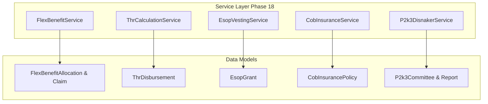

# DOKUMEN IMPLEMENTASI PHASE 18: CAFETERIA PLAN / FLEXIBLE BENEFITS, TUNJANGAN HARI RAYA (THR) STATUTORI & DENDA H-7 (PERMENAKER NO. 6/2016 JO. PP 58/2023), ESOP / RSU LONG-TERM INCENTIVES (UU NO. 40/2007), ASURANSI KOMERSIAL COB BPJS KESEHATAN (PERPRES NO. 82/2018), SERTA P2K3 & PELAPORAN TRIWULAN DISNAKER (PERMENAKER NO. 04/1987)

**Platform:** RiHRIS — Multi-Company SaaS HRIS Platform Indonesia  
**Modul:**  
1. Cafeteria Plan / Flexible Benefits & Plafon Poin Kesejahteraan (UU No. 13/2003 Pasal 100 & PMK 66/2023 Natura/Kenikmatan)  
2. Perhitungan THR Statutori, Denda Keterlambatan 5% H-7, & Pajak TER PPh 21 (Permenaker No. 6/2016 jo. PP 58/2023 & PMK 168/2023)  
3. Employee Stock Option Plan (ESOP / RSU) & Jadwal Vesting 4 Tahun dengan 1-Year Cliff (UU No. 40/2007 Perseroan Terbatas)  
4. Asuransi Kesehatan Tambahan & Koordinasi Manfaat / Coordination of Benefit (CoB) BPJS Kesehatan (Perpres No. 82/2018 jo. Permenkes No. 51/2018)  
5. Panitia Pembina Keselamatan & Kesehatan Kerja (P2K3) & Pelaporan Triwulan Disnaker (UU No. 1/1970 jo. Permenaker No. 04/1987)  
**Status Implementasi:** Production Ready (Completed)

---

## 1. DESKRIPSI & LANDASAN HUKUM INDONESIA

Fase 18 melengkapi arsitektur kompensasi & kepatuhan statutori enterprise RiHRIS dengan mekanisme benefit fleksibel modern, kepatuhan pembayaran THR keagamaan sesuai regulasi ketenagakerjaan, program kepemilikan saham untuk talenta kunci, efisiensi pembiayaan kesehatan melalui sinergi BPJS Kesehatan dan asuransi komersial, serta kelembagaan K3 formal yang terafiliasi dengan Dinas Tenaga Kerja setempat:

### 1.1 Cafeteria Plan / Flexible Benefits (UU No. 13/2003 Pasal 100 & PMK 66/2023)
- **Dasar Hukum**:
  - **UU No. 13 Tahun 2003 Pasal 100** tentang Fasilitas Kesejahteraan Karyawan.
  - **PMK No. 66/PMK.03/2023** tentang Perlakuan Pajak Penghasilan atas Penggantian atau Imbalan Sehubungan dengan Pekerjaan atau Jasa yang Diterima atau Diperoleh dalam Bentuk Natura dan/atau Kenikmatan.
- **Mekanisme Kerja**:
  1. Perusahaan memberikan plafon poin tahunan (1 Poin = Rp 1) kepada karyawan berdasarkan job grade atau masa kerja.
  2. Karyawan bebas membelanjakan poin sesuai prioritas gaya hidup dan kebutuhan pribadi:
     - *Optical & Dental*: Kacamata, lensa kontak, dan perawatan gigi.
     - *Wellness & Gym*: Keanggotaan pusat kebugaran, yoga, dan konsultasi nutrisi.
     - *Child Education*: SPP sekolah anak, perlengkapan belajar, dan kursus.
     - *Eco-Transport*: Langganan MRT/LRT/KRL komuter atau insentif kendaraan listrik.
     - *Medical Top-up*: Obat-obatan dan tindakan medis non-paket BPJS.
  3. Klaim diproses secara terintegrasi dengan validasi bukti kuitansi resmi dan otomatis memotong sisa saldo poin karyawan.

---

### 1.2 Tunjangan Hari Raya (THR) Statutori & Denda H-7 (Permenaker No. 6/2016 jo. PP 58/2023)
- **Dasar Hukum**:
  - **Permenaker No. 6 Tahun 2016** tentang Tunjangan Hari Raya Keagamaan bagi Pekerja/Buruh di Perusahaan.
  - **PP No. 36 Tahun 2021 jo. PP No. 51 Tahun 2023** tentang Pengupahan.
  - **PP No. 58 Tahun 2023 & PMK No. 168 Tahun 2023** tentang Tarif Efektif Rata-Rata (TER) Pemotongan Pajak PPh Pasal 21.
- **Ketentuan Yuridis Statutori**:
  1. **Hak & Masa Kerja (Pasal 2 & 3)**:
     - Masa kerja $\ge 12$ bulan secara terus menerus: Berhak atas **1 (satu) bulan upah penuh** (Gaji Pokok + Tunjangan Tetap).
     - Masa kerja $1 \le \text{tenure} < 12$ bulan: Diberikan secara proporsional dengan formula:
       $$\text{THR Pro-rata} = \frac{\text{Masa Kerja (Bulan)}}{12} \times 1\text{ Bulan Upah}$$
     - Masa kerja $< 1$ bulan: Tidak berhak atas THR keagamaan.
  2. **Batas Akhir Pembayaran Wajib (Pasal 5 ayat 4)**: Wajib dibayarkan paling lambat **7 (tujuh) hari sebelum hari raya keagamaan (H-7)**.
  3. **Sanksi Denda Keterlambatan (Pasal 10)**: Pengusaha yang terlambat membayar THR dikenai denda sebesar **5% (lima persen)** dari total THR yang harus dibayar sejak berakhirnya batas waktu H-7. Denda ini dikelola dan dipergunakan untuk kesejahteraan pekerja serta tidak menghilangkan kewajiban pengusaha untuk tetap membayar pokok THR.
  4. **Pajak PPh 21 TER**: Dihitung menggunakan Tarif Efektif Rata-Rata bulanan pada masa pajak pencairan THR.
  5. **Slip Resmi Statutori**: Sistem menghasilkan slip bukti pencairan THR resmi berstandar Kemnaker yang mencantumkan masa kerja, upah dasar, faktor pro-rata, denda keterlambatan jika ada, dan nominal bersih (*net*).

---

### 1.3 Employee Stock Option Plan (ESOP / RSU) (UU No. 40/2007)
- **Dasar Hukum**:
  - **UU No. 40 Tahun 2007** tentang Perseroan Terbatas.
  - Standar praktik tata kelola kompensasi eksekutif & insentif jangka panjang (*Long-Term Incentives / LTI*).
- **Struktur Kontrak & Jadwal Vesting**:
  1. **Jadwal Vesting 4 Tahun (48 Bulan)**: Distribusi hak pelaksanaan opsi saham berlangsung bertahap selama masa bakti 4 tahun.
  2. **Masa Cliff 1 Tahun (12 Bulan)**: Opsi belum dapat dieksekusi sebelum masa kerja mencapai 12 bulan dari tanggal grant; pada akhir bulan ke-12, sebesar $25\%$ hak opsi langsung terbuka (*vest*) sekaligus.
  3. **Vesting Bulanan Pascacliff**: Sisanya ($75\%$) melakukan *vesting* secara proporsional setiap bulan hingga bulan ke-48 ($100\%$).
  4. **Eksekusi Opsi (Exercise)**: Karyawan berhak menebus lembar saham *vested* pada harga pelaksanaan tetap (*Strike Price*). Sistem mengalkulasikan potensi keuntungan modal (*Intrinsic Capital Gain*):
     $$\text{Capital Gain} = \text{Lembar Opsi} \times (\text{Fair Market Value} - \text{Strike Price})$$

---

### 1.4 Asuransi Komersial & Coordination of Benefit (CoB) BPJS Kesehatan (Perpres 82/2018)
- **Dasar Hukum**:
  - **Peraturan Presiden No. 82 Tahun 2018** tentang Jaminan Kesehatan.
  - **Permenkes No. 51 Tahun 2018** tentang Pengenaan Urun Biaya dan Selisih Biaya dalam Program Jaminan Kesehatan.
- **Mekanisme Koordinasi Manfaat (CoB)**:
  1. **BPJS Kesehatan sebagai First Payer**: Menjamin biaya rumah sakit sesuai tarif INA-CBGs kelas kepesertaan dasar peserta.
  2. **Asuransi Komersial sebagai Secondary Top-Up Payer**: Menjamin selisih biaya (*cost-sharing*) yang timbul akibat peningkatan kelas perawatan (misal: naik ke ruang rawat VIP/VVIP) atau biaya non-formularium yang tidak dijamin paket BPJS.
  3. **Iur Biaya Pasien Nihil**: Mengeliminasi beban pembayaran tunai karyawan (*out-of-pocket*), memaksimalkan efisiensi anggaran korporat, dan menghindari terjadinya penagihan ganda (*double claim*).

---

### 1.5 P2K3 & Pelaporan Triwulan Disnaker (UU No. 1/1970 jo. Permenaker No. 04/1987)
- **Dasar Hukum**:
  - **UU No. 1 Tahun 1970** tentang Keselamatan Kerja.
  - **Permenaker No. PER-04/MEN/1987** tentang Panitia Pembina Keselamatan dan Kesehatan Kerja serta Tata Cara Penunjukan Ahli Keselamatan Kerja.
- **Kewajiban Kelembagaan & Audit Mandatori**:
  1. **Kriteria Wajib Pembentukan (Pasal 2)**: Setiap tempat kerja yang mempekerjakan **100 (seratus) orang pekerja atau lebih**, atau kurang dari 100 orang tetapi mempunyai tingkat bahaya risiko tinggi.
  2. **Struktur Pengurus Resmi (Pasal 3)**:
     - **Ketua P2K3**: Wajib dijabat oleh pimpinan puncak perusahaan / Direktur.
     - **Sekretaris P2K3**: Wajib dijabat oleh **Ahli K3 Umum yang memiliki Surat Keputusan Penunjukan (SKP)** dan lisensi aktif dari Menteri Ketenagakerjaan RI.
     - **Anggota Komite**: Komposisi seimbang antara wakil pengusaha dan wakil serikat pekerja/buruh.
  3. **Kewajiban Laporan Triwulan (Pasal 12)**: Sekurang-kurangnya **3 (tiga) bulan sekali** P2K3 wajib menyampaikan laporan tertulis mengenai kegiatan K3 kepada Kepala Kantor Departemen Tenaga Kerja (Disnaker) setempat, mencakup rekapitulasi inspeksi tempat kerja, pelatihan K3, analisis kecelakaan kerja (*Zero Accident*), dan rekomendasi tindak lanjut.

---

## 2. ARSITEKTUR STRUKTUR DATABASE (8 TABEL)

| Nama Tabel | Deskripsi Fungsional & Kepatuhan Statutori |
| :--- | :--- |
| `flex_benefit_categories` | Master kategori benefit (medical top-up, optical/dental, wellness, education, eco-transport). |
| `flex_benefit_allocations` | Plafon poin benefit tahunan per karyawan (1 Poin = Rp 1) dan saldo tersisa. |
| `flex_benefit_claims` | Pengajuan klaim penggantian biaya (reimbursement) lengkap dengan verifikasi kuitansi dan status approval. |
| `thr_disbursements` | Rekapitulasi statutori THR keagamaan, masa kerja, pengali pro-rata, TER PPh 21, batas bayar H-7, denda 5% telat bayar, dan net dibayarkan. |
| `esop_grants` | Kontrak opsi saham karyawan (ESOP/RSU), jadwal vesting 4 tahun, 12 bulan cliff, strike price, dan tracking saham dieksekusi. |
| `cob_insurance_policies` | Polis asuransi swasta tambahan terintegrasi CoB BPJS Kesehatan, plafon proteksi tahunan, dan pencatatan riwayat penjaminan selisih biaya. |
| `p2k3_committees` | Data kelembagaan Panitia Pembina K3, SK internal, nomor pengesahan Disnaker, Ketua (Pimpinan), dan SKP Ahli K3 Umum Kemnaker. |
| `p2k3_quarterly_reports` | Laporan berkala triwulan K3 Disnaker per 3 bulan (inspeksi bahaya, safety training, zero accident summary, nomor tanda terima Disnaker). |

---

## 3. ARSITEKTUR KELAS & SERVICE LAYER

1. **`App\Services\Financial\FlexBenefitService`**:
   - `allocatePoints(...)`: Menginisialisasi plafon benefit tahunan pekerja.
   - `submitClaim(...)`: Memvalidasi kecukupan sisa poin dan mencatat klaim reimbursement kuitansi.
   - `approveClaim(...)`: Menyetujui klaim dan memotong sisa poin plafon secara atomik.
   - `getCategoryUsageBreakdown(...)`: Statistik penyerapan anggaran per kategori benefit.
2. **`App\Services\Payroll\ThrCalculationService`**:
   - `computeStatutoryThr(...)`: Menghitung masa kerja per H-7 hari raya, menentukan pengali pro-rata, menghitung estimasi PPh 21 TER (PP 58/2023), mendeteksi pelanggaran batas waktu bayar H-7, dan mengalkulasikan denda keterlambatan 5% (Pasal 10 Permenaker 6/2016).
   - `recordThrDisbursement(...)`: Menyimpan riwayat pencairan THR resmi ke database.
3. **`App\Services\Financial\EsopVestingService`**:
   - `issueGrant(...)`: Menerbitkan kontrak opsi saham baru dengan masa cliff dan jadwal vesting.
   - `updateVestingProgress(...)`: Menghitung akumulasi lembar opsi yang telah memenuhi syarat *vesting* secara proporsional.
   - `exerciseOptions(...)`: Memproses eksekusi penebusan saham *vested* oleh pekerja, menghitung biaya pelaksanaan (*strike cost*), dan potensi keuntungan modal (*intrinsic capital gain*).
4. **`App\Services\Compliance\CobInsuranceService`**:
   - `registerPolicy(...)`: Mendaftarkan polis komersial top-up pekerja yang tersinkronisasi nomor BPJS Kesehatan.
   - `coordinateClaim(...)`: Mensimulasikan koordinasi manfaat rumah sakit: BPJS sebagai penjamin pertama (INA-CBGs), asuransi komersial menutup selisih biaya kamar/obat hingga limit polis, menghasilkan iur biaya (*out-of-pocket*) pasien Rp 0.
5. **`App\Services\Compliance\P2k3DisnakerService`**:
   - `assessMandatoryCompliance(...)`: Mengevaluasi kewajiban pembentukan P2K3 berdasarkan ambang batas 100 tenaga kerja atau risiko tinggi (Pasal 2 Permenaker 04/1987).
   - `registerCommittee(...)`: Memvalidasi keabsahan Nomor SKP Ahli K3 Umum Kemnaker RI Sekretaris P2K3.
   - `submitQuarterlyReport(...)`: Menyusun dan mendokumentasikan laporan kegiatan triwulan P2K3 berstandar formulir Disnaker.

---

## 4. DAFTAR ROUTE & ENDPOINT KONTROL

| URI Endpoint | Nama Route | HTTP Method | Fungsi Bisnis |
| :--- | :--- | :---: | :--- |
| `/flex-benefits` | `flex-benefits.index` | `GET` | Dashboard cafeteria flex-benefits & daftar alokasi poin |
| `/flex-benefits/categories` | `flex-benefits.categories.store` | `POST` | Pendaftaran master kategori benefit fleksibel |
| `/flex-benefits/allocations` | `flex-benefits.allocations.store` | `POST` | Alokasi plafon poin benefit tahunan karyawan |
| `/flex-benefits/claims` | `flex-benefits.claims.store` | `POST` | Pengajuan klaim reimbursement benefit kuitansi |
| `/flex-benefits/claims/{claim}/approve` | `flex-benefits.claims.approve` | `POST` | Persetujuan klaim & pemotongan saldo poin |
| `/flex-benefits/claims/{claim}/reject` | `flex-benefits.claims.reject` | `POST` | Penolakan berkas klaim reimbursement |
| `/thr-disbursements` | `thr-disbursements.index` | `GET` | Dashboard perhitungan THR statutori & audit denda H-7 |
| `/thr-disbursements/calculate` | `thr-disbursements.calculate` | `POST` | Eksekusi massal / individu kalkulasi THR Permenaker 6/2016 |
| `/thr-disbursements/{disbursement}/mark-paid` | `thr-disbursements.mark-paid` | `POST` | Tandai pembayaran THR lunas |
| `/thr-disbursements/{disbursement}/print-slip`| `thr-disbursements.print-slip` | `GET` | Cetak slip resmi THR statutori |
| `/esop` | `esop.index` | `GET` | Dashboard manajemen kontrak opsi saham ESOP / RSU |
| `/esop` | `esop.store` | `POST` | Penerbitan kontrak opsi saham baru |
| `/esop/{grant}/refresh-vesting` | `esop.refresh-vesting` | `POST` | Sinkronisasi progres vesting berdasarkan masa kerja |
| `/esop/{grant}/exercise` | `esop.exercise` | `POST` | Eksekusi opsi saham vested & kalkulasi capital gain |
| `/cob-insurance` | `cob-insurance.index` | `GET` | Manajemen polis asuransi komersial CoB BPJS Kesehatan |
| `/cob-insurance` | `cob-insurance.store` | `POST` | Pendaftaran polis asuransi tambahan top-up |
| `/cob-insurance/coordinate-claim` | `cob-insurance.coordinate-claim` | `POST` | Simulasi koordinasi klaim CoB rumah sakit |
| `/p2k3` | `p2k3.index` | `GET` | Dashboard lembaga P2K3 & laporan triwulan Disnaker |
| `/p2k3/committee` | `p2k3.committee.store` | `POST` | Pendaftaran / perbaruan susunan pengurus P2K3 & SKP Ahli K3 |
| `/p2k3/reports` | `p2k3.reports.store` | `POST` | Penyusunan laporan triwulan kegiatan K3 ke Disnaker |
| `/p2k3/reports/{report}/print` | `p2k3.reports.print` | `GET` | Cetak formulir resmi laporan triwulan P2K3 Disnaker |

---

## 5. FEATURE TEST SUITE KEPATUHAN STATUTORI

Pengujian otomatis komprehensif tertulis pada [`tests/Feature/AdvancedEnterpriseCompliancePhase18Test.php`](file:///Users/legacygandawijaya/Documents/hris-php/tests/Feature/AdvancedEnterpriseCompliancePhase18Test.php) dengan 12 metode uji:
1. `test_flex_benefit_allocation_and_point_deduction_lifecycle`: Siklus alokasi poin (5jt), pengajuan klaim (1.5jt), persetujuan dan deduksi sisa poin (3.5jt).
2. `test_flex_benefit_claim_rejects_when_points_insufficient`: Validasi penolakan pengajuan klaim yang melebihi plafon poin tersisa.
3. `test_statutory_thr_full_one_month_wage_for_tenure_twelve_months_or_more`: Memverifikasi masa kerja $\ge 12$ bulan mendapatkan pengali 1.0 penuh dari gaji pokok + tunjangan tetap.
4. `test_statutory_thr_prorata_calculation_for_tenure_between_one_and_eleven_months`: Memverifikasi pekerja masa kerja 6 bulan mendapatkan THR tepat $\frac{6}{12} \times \text{upah}$.
5. `test_statutory_thr_ineligible_for_tenure_less_than_one_month`: Karyawan dengan masa kerja $< 1$ bulan tidak berhak mendapatkan THR sesuai Pasal 2 Permenaker 6/2016.
6. `test_statutory_thr_late_payment_penalty_five_percent_under_pasal_10_permenaker_6_2016`: Memverifikasi pembayaran melewati batas waktu statutori H-7 otomatis dikenai denda keterlambatan 5%.
7. `test_statutory_thr_disbursement_record_and_status_update`: Memverifikasi persistensi data pencairan THR, pemotongan TER PPh 21, dan pembaruan status lunas.
8. `test_esop_vesting_cliff_enforcement_under_one_year`: Memverifikasi sebelum masa cliff 12 bulan hak opsi bernilai 0, dan setelah 24 bulan dari 48 bulan mencapai 50% *vested*.
9. `test_esop_option_exercise_and_capital_gain_calculation`: Eksekusi opsi saham *vested*, validasi biaya penebusan *strike price*, dan *intrinsic capital gain*.
10. `test_cob_insurance_bpjs_kesehatan_first_payer_and_commercial_topup`: Simulasi tagihan RS Rp 25jt, BPJS menanggung Rp 15jt, asuransi swasta menutup selisih Rp 10jt, sehingga iur biaya pasien Rp 0.
11. `test_p2k3_mandatory_compliance_audit_workforce_threshold`: Evaluasi ambang batas 100 tenaga kerja atau risiko tinggi sebagai dasar kewajiban pembentukan P2K3 (Permenaker 04/1987).
12. `test_p2k3_committee_registration_requires_valid_ahli_k3_skp_and_quarterly_reporting`: Memverifikasi pendaftaran P2K3 menolak jika nomor SKP Ahli K3 kosong, serta mencatat laporan triwulan resmi Disnaker.

---

## 6. STATUS ROADMAP ENTERPRISE PLATFORM (20 FASE)

Dengan diselesaikannya **Phase 18**, platform RiHRIS telah menuntaskan **18 dari 20 Fase** pada *master enterprise blueprint*:
- **Phase 1 - 15**: Core HR, Tenancy, Payroll, BPJS, PPh 21 TER, Talenta, K3 Insiden, LKS Bipartit, dan Audit Disabilitas.
- **Phase 16**: TKA & RPTKA, JKP BPJS Ketenagakerjaan, Koperasi Karyawan, Pola Shift Khusus 24/7, dan Mediasi Tripartit PPHI (UU 2/2004).
- **Phase 17**: Alih Daya & TUPE (PP 35/2021), Serikat Pekerja & PKB (UU 21/2000), Satgas PPKS & Fasilitas Ramah Perempuan (Kepmenaker 88/2023), Pensiun Dini (VSS) & DPLK (UU 4/2023), serta Pemagangan Terstruktur (Permenaker 6/2020).
- **Phase 18 (Completed)**: Cafeteria Flex-Benefits, THR Statutori & Denda H-7 (Permenaker 6/2016), ESOP 4-Year Vesting (UU 40/2007), CoB BPJS Kesehatan (Perpres 82/2018), serta Komite P2K3 & Laporan Triwulan Disnaker (Permenaker 04/1987).
- **Phase 19 & 20 (Sisa 2 Fase)**:
  - **Phase 19**: ESG & Corporate Sustainability Reporting Ketenagakerjaan (OJK POJK 51/2017 & GRI Standards: Emisi Scope 1-3 Komuter, Rasio Upah Gender, Keberagaman Direksi), serta AI Workload Stress & Ergonomi Digital.
  - **Phase 20**: Disaster Recovery, High-Availability Multi-Region Failover, Enterprise Data Privacy & PDP Law Compliance (UU No. 27/2022 Pelindungan Data Pribadi: Hak Portabilitas Data, DPO Audit, Enkripsi Kunci HSM & Zero Trust Security).
