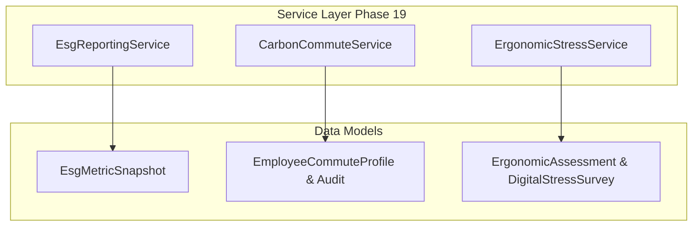

# DOKUMEN IMPLEMENTASI PHASE 19: ESG KETENAGAKERJAAN & CORPORATE SUSTAINABILITY (POJK NO. 51/2017 & GRI STANDARDS), EMISI KARBON KOMUTER SCOPE 3 (GHG PROTOCOL), SERTA ERGONOMI K3 & INDEKS BEBAN KERJA DIGITAL (PERMENAKER NO. 5/2018)

**Platform:** RiHRIS — Multi-Company SaaS HRIS Platform Indonesia  
**Modul:**  
1. Laporan Keberlanjutan Ketenagakerjaan ESG (OJK POJK No. 51/POJK.03/2017 & Standar Global Reporting Initiative / GRI 401, 403, 404, 405)  
2. Analisis Rasio Upah Setara Gender (Gender Pay Gap Ratio GRI 405-2) & Keterwakilan Kepemimpinan Wanita di Manajemen & Direksi (GRI 405-1)  
3. Jejak Karbon Komuter Karyawan (Scope 3 GHG Protocol Kategori 7) & Penghematan Emisi Melalui Kebijakan Flexible Working Arrangement (FWA/WFH)  
4. Audit Ergonomi Tempat Kerja Stasiun Komputer & Pengukuran Intensitas Pencahayaan Minimal 300 Lux (Permenaker No. 5 Tahun 2018 K3 Lingkungan Kerja)  
5. Indeks Beban Kerja Mental Digital, Computer Vision Syndrome, & Mitigasi Burnout Kognitif (Right to Disconnect & Aturan 20-20-20)  
**Status Implementasi:** Production Ready (Completed)

---

## 1. DESKRIPSI & LANDASAN HUKUM INDONESIA

Fase 19 memperluas kapabilitas RiHRIS ke ranah tata kelola keberlanjutan korporat (*Corporate Sustainability & ESG*), akuntabilitas iklim (*Climate Decarbonization*), serta kesehatan mental dan fisik pekerja era digital sesuai regulasi OJK dan Kementerian Ketenagakerjaan:

### 1.1 Laporan Keberlanjutan ESG Ketenagakerjaan (OJK POJK No. 51/POJK.03/2017 & GRI 401/404/405)
- **Dasar Hukum**:
  - **Peraturan OJK No. 51/POJK.03/2017** tentang Penerapan Keuangan Berkelanjutan bagi Lembaga Jasa Keuangan, Emiten, dan Perusahaan Publik.
  - **Surat Edaran OJK No. 16/SEOJK.04/2021** tentang Bentuk dan Isi Laporan Tahunan Emiten atau Perusahaan Publik.
  - **Global Reporting Initiative (GRI Standards)**:
    - *GRI 401: Employment* (Pergantian tenaga kerja / turnover rate & rekrutmen baru).
    - *GRI 403: Occupational Health and Safety* (Tingkat frekuensi cedera hilang waktu kerja / LTIFR).
    - *GRI 404: Training and Education* (Rata-rata jam pelatihan tahunan per karyawan).
    - *GRI 405: Diversity and Equal Opportunity* (Keberagaman gender, usia, dan rasio remunerasi setara).
- **Indikator Kinerja Kunci (KPI)**:
  1. **Rasio Upah Setara Gender (*Gender Pay Gap Ratio*)**:
     $$\text{Gender Pay Ratio} = \frac{\text{Rata-rata Gaji Pokok Pekerja Perempuan}}{\text{Rata-rata Gaji Pokok Pekerja Laki-laki}}$$
     Target ideal kepatuhan nondiskriminatif (Pasal 5 & 6 UU 13/2003) berkisar antara **$0.9500 \text{ s/d } 1.0500$** pada jenjang jabatan dan tanggung jawab yang setara.
  2. **Keterwakilan Kepemimpinan & Diversitas Direksi**:
     Mengukur persentase wanita dalam posisi manajerial (*female leadership %*) serta proporsi anggota perempuan di Dewan Direksi dan Dewan Komisaris (*board diversity %*).
  3. **Jam Pelatihan Tahunan per Karyawan (GRI 404-1)**:
     Agregasi realisasi pelatihan L&D yang telah diselesaikan pekerja untuk membuktikan pemenuhan hak peningkatan kompetensi kerja (Pasal 11 UU 13/2003).

---

### 1.2 Jejak Karbon Komuter Karyawan (Scope 3 GHG Protocol Kategori 7)
- **Dasar Hukum & Kerangka Kerja**:
  - **Perpres No. 98 Tahun 2021** tentang Penyelenggaraan Nilai Ekonomi Karbon untuk Pencapaian Target Kontribusi yang Ditetapkan Secara Nasional dan Pengendalian Emisi Gas Rumah Kaca dalam Pembangunan Nasional.
  - **Greenhouse Gas (GHG) Protocol Corporate Value Chain (Scope 3) Standard**: Kategori 7 (*Employee Commuting*).
  - Faktor Emisi Baku DEFRA / IPCC per penumpang-kilometer ($\text{kg CO}_2\text{e / km}$):
    - Mobil Bensin Pribadi (*Car Gasoline*): **$0.192\text{ kg CO}_2\text{e / km}$**
    - Sepeda Motor Bensin (*Motorcycle Gasoline*): **$0.103\text{ kg CO}_2\text{e / km}$**
    - Kendaraan Listrik (*Electric Vehicle / EV*): **$0.053\text{ kg CO}_2\text{e / km}$**
    - Transportasi Publik (KRL Komuter, MRT Jakarta, LRT, TransJakarta): **$0.041\text{ kg CO}_2\text{e / km}$**
    - Sepeda Kayuh & Jalan Kaki (*Active Commuting*): **$0.000\text{ kg CO}_2\text{e / km}$**
- **Kalkulasi Reduksi Emisi Berkat Skema Kerja Hybrid (WFH/FWA)**:
  Sistem menghitung emisi kotor (*gross emissions*) bila karyawan 100% bekerja di kantor (WFO), kemudian membandingkannya dengan emisi riil setelah dipotong hari kerja jarak jauh (*remote work / WFH*). Selisihnya dicatat sebagai **Emisi yang Dihindari (*Avoided Carbon Emissions*)** dalam laporan keberlanjutan tahunan perusahaan.

---

### 1.3 Ergonomi Tempat Kerja & Beban Kerja Mental Digital (Permenaker No. 5/2018)
- **Dasar Hukum**:
  - **Permenaker No. 5 Tahun 2018** tentang Keselamatan dan Kesehatan Kerja Lingkungan Kerja (Pasal 23 s/d 24 tentang Faktor Ergonomi & Lampiran Standar Pencahayaan).
- **Ketentuan Audit Fisik Stasiun Kerja**:
  1. **Intensitas Penerangan Ruang Komputer**: Minimal **300 Lux** pada bidang kerja tanpa menimbulkan silau pantulan (*glare*) pada layar monitor.
  2. **Kelengkapan Ergonomis Wajib**:
     - Kursi dengan penopang lekuk pinggang (*lumbar support adjustable*).
     - Ketinggian tepi atas layar monitor sejajar garis horizontal pandangan mata (*eye-level*).
     - Bantalan penyangga pergelangan tangan (*wrist rest*) untuk mencegah *Carpal Tunnel Syndrome (CTS)*.
  3. **Tingkat Risiko Postur**:
     - Skor $\ge 80$: Rendah (*Low Risk - Kondisi Optimal*)
     - Skor $60 - 79$: Sedang (*Moderate Risk*)
     - Skor $< 60$: Tinggi (*High Risk - Action Required*)
- **Survei Beban Kerja Digital & Screen Fatigue**:
  Mengukur durasi paparan layar monitor (*screen time*), kelelahan rapat daring (*meeting/Zoom fatigue*), frekuensi gangguan komunikasi di luar jam kerja (*after-hours disruption*), dan gejala *Computer Vision Syndrome (CVS)*. Sistem menghasilkan skor **Digital Burnout Risk Index (0 - 100)** beserta rekomendasi hak pemutusan komunikasi (*Right to Disconnect*) dan penerapan aturan visual 20-20-20.

---

## 2. ARSITEKTUR STRUKTUR DATABASE (5 TABEL)

| Nama Tabel | Deskripsi Fungsional & Kepatuhan Statutori |
| :--- | :--- |
| `esg_metric_snapshots` | Snapshot metrik ESG tahunan perusahaan: rasio upah gender (GRI 405-2), persentase kepemimpinan perempuan, jam training (GRI 404-1), turnover rate (GRI 401-1), dan LTIFR (GRI 403-9). |
| `employee_commute_profiles` | Profil perjalanan harian karyawan: jarak satu arah rumah-kantor, moda transportasi utama, alokasi hari WFO vs WFH, serta kalkulasi emisi mingguan dan emisi yang dihemat. |
| `commute_emission_audits` | Audit tahunan emisi komuter Scope 3 perusahaan (50 minggu kerja), menghitung total jarak (km), emisi bruto (ton), emisi dihindari (ton), dan net emisi karbon riil. |
| `ergonomic_assessments` | Hasil inspeksi K3 ergonomi lingkungan kerja per stasiun komputer: intensitas cahaya Lux meter, kursi lumbar, eye-level monitor, wrist rest, skor kepatuhan, dan tingkat risiko postur (Permenaker 5/2018). |
| `digital_stress_surveys` | Catatan survei beban mental & kelelahan kognitif digital karyawan: rata-rata jam layar monitor, skor meeting fatigue, indeks risiko burnout (0-100), dan rekomendasi pemulihan. |

---

## 3. ARSITEKTUR KELAS & SERVICE LAYER

1. **`App\Services\Compliance\EsgReportingService`**:
   - `generateAnnualSnapshot(...)`: Mengagregasi data karyawan aktif, menghitung rasio upah gender, proporsi pimpinan wanita di tingkat manajerial dan dewan direksi, rata-rata jam pelatihan, dan mencatat snapshot keberlanjutan resmi POJK 51/2017.
2. **`App\Services\Compliance\CarbonCommuteService`**:
   - `updateEmployeeCommute(...)`: Menghitung emisi karbon mingguan berdasarkan faktor emisi DEFRA/IPCC dan mengukur penghematan karbon dari hari kerja WFH.
   - `runAnnualCommuteAudit(...)`: Mengagregasi data komuter seluruh pekerja selama 50 minggu operasional menjadi metrik ton $\text{CO}_2\text{e}$ Scope 3.
3. **`App\Services\Safety\ErgonomicStressService`**:
   - `recordErgonomicAssessment(...)`: Mengevaluasi kesesuaian stasiun kerja terhadap baku mutu fisik Permenaker 5/2018 (300 Lux, lumbar support, eye level, wrist rest).
   - `recordStressSurvey(...)`: Mengalkulasikan indeks risiko burnout kognitif (*Digital Burnout Risk Index*) dan menerbitkan saran intervensi kesehatan kerja.

---

## 4. DAFTAR ROUTE & ENDPOINT KONTROL

| URI Endpoint | Nama Route | HTTP Method | Fungsi Bisnis |
| :--- | :--- | :---: | :--- |
| `/esg` | `esg.index` | `GET` | Dashboard metrik keberlanjutan ESG & riwayat snapshot |
| `/esg/generate` | `esg.generate` | `POST` | Hitung ulang snapshot metrik ESG tahunan POJK 51/2017 |
| `/esg/{snapshot}/print` | `esg.print` | `GET` | Cetak dokumen resmi Sustainability Statement POJK 51 |
| `/carbon-commute` | `carbon-commute.index` | `GET` | Dashboard jejak karbon komuter Scope 3 & audit tahunan |
| `/carbon-commute/profiles` | `carbon-commute.profiles.store` | `POST` | Pendaftaran / pembaruan profil komuter & moda transport |
| `/carbon-commute/audit` | `carbon-commute.audit.run` | `POST` | Eksekusi audit emisi karbon komuter tahunan perusahaan |
| `/ergonomics` | `ergonomics.index` | `GET` | Dashboard audit ergonomi K3 & survei beban digital |
| `/ergonomics/assessments` | `ergonomics.assessments.store` | `POST` | Input audit fisik stasiun kerja per Permenaker 5/2018 |
| `/ergonomics/surveys` | `ergonomics.surveys.store` | `POST` | Input survei beban kerja digital & kalkulasi burnout index |

---

## 5. FEATURE TEST SUITE KEPATUHAN STATUTORI

Pengujian otomatis komprehensif tertulis pada [`tests/Feature/AdvancedEnterpriseCompliancePhase19Test.php`](file:///Users/legacygandawijaya/Documents/hris-php/tests/Feature/AdvancedEnterpriseCompliancePhase19Test.php) dengan 12 metode uji:
1. `test_esg_metric_snapshot_generation_calculates_gender_pay_gap_ratio`: Verifikasi akurasi matematis rasio upah gender (GRI 405-2) pada jenjang jabatan setara.
2. `test_esg_metric_snapshot_female_workforce_and_leadership_diversity_percentage`: Verifikasi persentase keterwakilan pekerja wanita dan rasio kepemimpinan manajerial wanita (GRI 405-1).
3. `test_esg_metric_snapshot_board_diversity_and_training_hours`: Verifikasi diversitas dewan direksi/komisaris dan rata-rata jam pelatihan L&D tahunan (GRI 404-1).
4. `test_esg_metric_snapshot_turnover_and_ltifr_calculation`: Verifikasi penghitungan turnover rate tahunan (GRI 401-1) dan tingkat insiden kecelakaan kerja LTIFR (GRI 403-9).
5. `test_carbon_commute_profile_calculates_weekly_emissions_for_car_gasoline`: Pengujian formula emisi mobil bensin ($40\text{ km roundtrip} \times 4\text{ hari} \times 0.192 = 30.72\text{ kg CO}_2\text{e}$).
6. `test_carbon_commute_profile_calculates_avoided_emissions_from_wfh`: Pengujian emisi yang dihindari berkat WFH mobil listrik ($40\text{ km} \times 2\text{ hari WFH} \times 0.053 = 4.24\text{ kg CO}_2\text{e}$).
7. `test_carbon_commute_rejects_invalid_transport_mode_or_negative_distance`: Validasi penolakan jarak negatif dan moda transportasi yang tidak terdaftar.
8. `test_carbon_commute_annual_scope_three_audit_aggregation`: Pengujian agregasi tahunan 50 minggu ke metrik ton $\text{CO}_2\text{e}$ kotor, emisi dihindari, dan net emisi.
9. `test_ergonomic_assessment_full_compliance_score_and_low_risk`: Stasiun kerja dengan 350 Lux, kursi lumbar, eye-level monitor, dan wrist rest mencapai skor 100 (*Low Risk*).
10. `test_ergonomic_assessment_substandard_lighting_and_accessories_action_required`: Stasiun kerja dengan pencahayaan redup (< 200 Lux) dan tanpa penopang ergonomis mendapatkan skor rendah (< 60) dan status *action_required*.
11. `test_digital_stress_survey_computes_burnout_risk_index_and_low_classification`: Beban kerja seimbang (7 jam layar, fatigue rendah) menghasilkan indeks burnout < 35 (*Low Risk*).
12. `test_digital_stress_survey_detects_severe_burnout_risk_for_excessive_workload`: Beban kerja ekstrem (14 jam layar, meeting fatigue 5/5, chat konstan di luar jam kerja) memicu klasifikasi risiko *severe* dan rekomendasi intervensi psikologis kerja.

---

## 6. STATUS ROADMAP ENTERPRISE PLATFORM (20 FASE)

Dengan diselesaikannya **Phase 19**, platform RiHRIS telah menuntaskan **19 dari 20 Fase** pada *master enterprise blueprint*:
- **Phase 1 - 18**: Foundation, Tenancy, Core HR, Payroll, BPJS, PPh 21 TER, Talenta, K3 SMK3, LKS Bipartit, Kuota Disabilitas, TKA RPTKA, JKP BPJS, Roster 24/7, PPHI Tripartit, Alih Daya TUPE, Serikat Pekerja PKB, Satgas PPKS, VSS Pensiun Dini, Pemagangan, Cafeteria Flex-Benefits, THR Statutori & Denda H-7, ESOP 4-Year Vesting, CoB BPJS Kesehatan, dan P2K3 Disnaker.
- **Phase 19 (Completed)**: ESG Sustainability Reporting (POJK 51/2017 & Standar GRI 401/404/405), Jejak Karbon Komuter Scope 3 GHG Protocol, serta Audit Ergonomi Stasiun Kerja & Beban Digital (Permenaker 5/2018).
- **Phase 20 (Sisa 1 Fase Terakhir Menuju 100% Selesai)**:
  - **Phase 20**: Disaster Recovery, High-Availability Multi-Region Failover, Enterprise Data Privacy & PDP Law Compliance (UU No. 27/2022 Pelindungan Data Pribadi: Hak Portabilitas Data, DPO Audit, Enkripsi Kunci HSM & Zero Trust Security).
